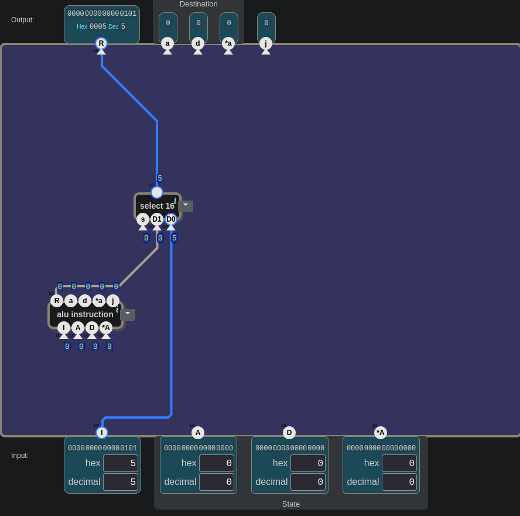
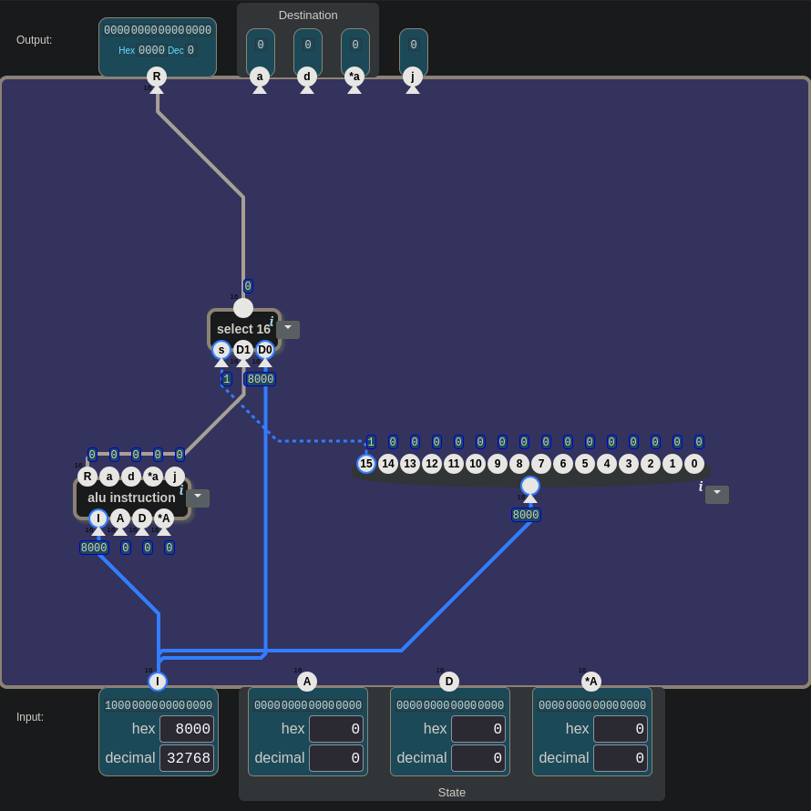
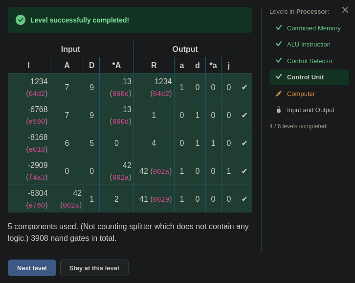

# 🧮 From Switches to a Computer — Control Unit: One Bit, Two Kinds of Instruction

> In this level the computer learned a second kind of instruction. The first wire
> took the leftmost bit of the instruction straight to R, and R showed 0 instead
> of 5. When asked which bits should go to R, the answer was "all of them." Then a
> 1 was needed, and the question came: "isn't there a 1 already somewhere in the
> circuit?" The first Check passed, but a bug the game had missed was found
> afterwards with a test written by hand. At the end, the five selectors lined up
> at the top looked familiar.

---

## 📋 Table of Contents

- [What Does This Part Do?](#what-does-this-part-do)
- [Read Value, Write Permission](#read-value-write-permission)
- [R: One Leg or All of Them?](#r-one-leg-or-all-of-them)
- [When the Lever Is Left Loose](#when-the-lever-is-left-loose)
- [How Do You Test a Selector?](#how-do-you-test-a-selector)
- [a: Is There a Ready-Made 1?](#a-is-there-a-ready-made-1)
- [d, *a, j: Where Does the 0 Come From?](#d-a-j-where-does-the-0-come-from)
- [The Bug the Game Missed](#the-bug-the-game-missed)
- [The Five Looked Familiar](#the-five-looked-familiar)
- [🎮 Now You Build It](#-now-you-build-it)
- [Two Open Questions](#two-open-questions)

---

## What Does This Part Do?

The fourth level of the Processor unit. Here's the scene:

```
inputs:     I (16 bits, instruction) · A · D · *A (16 bits each)
outputs:    R (16 bits) · a · d · *a · j (1 bit each)
toolbox:    nand · or · control selector · alu instruction · 16 bit splitter ·
            16 bit bundler · select · select 16 · is neg · inv · 0
```

The inputs and outputs are the same as in
[23](./23_alu_instruction.md#what-does-this-part-do). In the toolbox, the circuit
you built in 23 is ready under the name `alu instruction`, and the one you built
in 24 under the name `control selector`.

The window that opens:

> *"In addition to the ALU instructions, the computer should also support **data
> instructions**. In a data instruction, the instruction value is directly written
> to the A register. Create a control unit which executes either a data or ALU
> instruction, depending on the high bit of the instruction `I`:"*

| bit 15 | |
|:-:|---|
| 0 | data instruction |
| 1 | ALU instruction |

> *"For ALU instructions, the output should be as specified in the previous level.
> R is the result of the ALU operation. For a data instruction, the output R should
> be the `I` input, and destination should be the A register. I.e. `a` should be 1
> and `d`, `*a`, and `j` flags should be 0."*

In one sentence: *look at the leftmost bit of the instruction; if it's 0, the
instruction itself is a number, write it to A; if it's 1, run the instruction as
in the previous level.*

You can think of the two kinds of instruction as two kinds of slip. A data
instruction is a note with only a number on it: "write this to A." An ALU
instruction is a work order: which operation to do, which values to use, where to
put the result. A single mark in the corner tells you which kind of slip it is:
bit 15.

| bit 15 | kind | R | `a` | `d` | `*a` | `j` |
|:-:|---|:-:|:-:|:-:|:-:|:-:|
| 0 | data instruction | `I` | 1 | 0 | 0 | 0 |
| 1 | ALU instruction | as in 23 | as in 23 | as in 23 | as in 23 | as in 23 |

In [21.5](./21.5_sayi_mi_komut_mu.md#when-a-number-becomes-a-command) you saw that
a number becomes a command when its bits are connected to control wires. Here the
same 16 bits have two possible fates: if bit 15 = 1, the remaining bits tell the
ALU what to do; if bit 15 = 0, none of them is read as a control wire, and the 16
bits go to A as a number.

Bit 15 is the leg labeled 15: the **leftmost** digit of the 16-digit binary
number in the `I` box. Numbering starts from the right, at 0 (the rule from
[23](./23_alu_instruction.md#12th-bit-and-bit-12)).

> 💡 **Reading bit 15 in hex:** every hex digit is four bits. If the leftmost digit
> is `0`–`7`, bit 15 = 0; if it's `8`–`f`, bit 15 = 1. `0005` → 0, `8000` → 1,
> `f4a3` → 1.

---

## Read Value, Write Permission

In the middle of the level a question got stuck: *"Does bit 15 have to give 1
when all of them are 1 at once?"* "All of them" here meant `A`, `D` and `*A` at
the bottom.

Bit 15 has nothing to do with them. Bit 15 comes only from `I`. There are two
separate groups on the screen:

```
BOTTOM (inputs, come from outside)
  I            →  the instruction. Bit 15 lives only here.
  A · D · *A   →  the values sitting in the registers and in RAM RIGHT NOW. Read values.

TOP (outputs, the circuit produces them)
  R            →  the result
  a · d · *a   →  where should the result be written? Write permissions.
  j            →  does the result meet the condition?
```

The rule from [22](./22_combined_memory.md#lowercase-uppercase): lowercase is a
write permission, uppercase is a read value. What bit 15 decides is the five
outputs at the top.

Notice one more thing: in a data instruction, `A`, `D` and `*A` are never looked
at, because R = `I`. The read values only matter in an ALU instruction, when a
calculation is done.

---

## R: One Leg or All of Them?

The first connection was this: `I` went into a `16 bit splitter`, and leg 15 of
the splitter went straight to R. The reasoning: *"Whether bit 15 is 0 or 1 is
what concerns us, because we'll go to the outputs based on it."*


*The first connection. The wire from the splitter's leftmost leg (15) goes to R; the R of `alu instruction` is unconnected.*

To test it, `5` was written into `I`. A data instruction, so R should have shown
5. It showed 0.

```
I = 5  =  0000 0000 0000 0101
          ↑               ↑ ↑
       bit 15 = 0      bit 2 and bit 0 = 1
```

The leg connected to R was bit 15, and in 5 that bit is 0. That's where the 0 on
R came from.

The next question: *what has to go to R to see 5 there?* The first answer was
*"bits 2 and 0."* Correct for 5. But what if `I` = 6? `0110`: this time bit 2 and
bit 1. Every number turns on different bits. The circuit has to work not just for
5 but for every data instruction that might come. The answer turned into: *"All
of them, then."*

A wire carrying all 16 bits at once was already in the circuit: *"The wire coming
out of I, before it enters the splitter."*

> 🔑 **A leg carries a single bit. The number itself is on the wire that carries
> the number.**

But R has two candidates:

| bit 15 | goes to R |
|:-:|---|
| 0 | the wire coming out of `I` |
| 1 | the R of `alu instruction` |

The part that looks at one bit and picks one of two 16-bit values: *"select 16."*
What must pass while `s` = 0 goes to D0, so `I` → D0 and the R of
`alu instruction` → D1 (the trap from
[13](./13_arithmetic_unit.md#the-trap-d0-and-d1-are-just-socket-names)).

---

## When the Lever Is Left Loose

With `select 16` in place, `5` was written into `I` again. R showed 5. That was
the expected value.


*`I` = 5, R = 5. But no wire reaches the `s` leg of `select 16`.*

Question: *what is connected to the `s` of `select 16`?* Answer: *"Nothing."*

In the game an unconnected input counts as 0 (the 🎮 box in
[22](./22_combined_memory.md#when-a-wire-is-left-loose); in reality a floating
input is undefined). With `s` = 0, the selector always passed D0, that is `I`.
The test passed **by chance**: a data instruction was tried, so D0 passing was
correct anyway. In [23](./23_alu_instruction.md#tests-that-passed-by-chance) the
first two tests passed the same way while the control wires were loose.

What has to be connected to `s` is bit 15: the leg labeled 15 on the splitter.
That leg is at the **far left** of the splitter. The number on the leg always
tells the truth.

---

## How Do You Test a Selector?

After `s` was connected to bit 15, `8000` (32768) was written into `I`: bit 15 =
1, an ALU instruction. This was on the screen:

```
D0 = 8000   (comes from I)
D1 = 0      (comes from the R of alu instruction)
s  = 1
R  = 0
```


*`I` = `8000` (32768). The dashed blue wire goes from bit 15 to `s`; `s` = 1, R shows 0.*

The first impression: *"s became 1 but D1 didn't trigger."* D1 is not a trigger,
it carries a value. At that moment the R of `alu instruction` was 0; the selector
passed it.

The check took a single question: *if D0 had been selected, what would R show?*
8000. R shows 0, so D1 was selected.

> 🔑 **The value at the output tells you which leg the selector passed.** Compare
> the output with both inputs; whichever it equals is the one that passed. If the
> two inputs hold the same value, the test tells you nothing; use different values,
> as in [24](./24_control_selector.md#test-with-different-values).

---

## a: Is There a Ready-Made 1?

R is done; next come the flags at the top. First `a`:

| bit 15 | `a` |
|:-:|---|
| 0 | 1 |
| 1 | the `a` of `alu instruction` |

`a` is a single bit, so `select`, not `select 16`: `s` ← bit 15, `d1` ← the `a`
of `alu instruction`. But `d0` needs a **1**.

In [13](./13_arithmetic_unit.md#who-will-produce-the-constant-1) the constant 1
was made from a `0` and an `inv`. Here a question was asked: *"Without using these
two gates, isn't there anything we already have that can produce a 1? Can't we
take it from somewhere already in the circuit?"*

There is no ready-made 1 without a gate. Here's the proof: in a data instruction,
the other 15 bits of `I` are data, so they can be anything. `I` = 0 can come. Then
every leg of the splitter is 0, and so is every single-bit output of
`alu instruction`. There is no wire you can count on to be "always 1 in a data
instruction." At least one gate is required.

But describing the wire you're looking for helps:

| bit 15 | the wire you need |
|:-:|:-:|
| 0 | 1 |
| 1 | doesn't matter: the selector isn't looking at `d0` then |

A single gate meets this description: **`inv`(bit 15)**. Only `inv` instead of
`0` + `inv`, so one part instead of two.

Then another worry came up: *"Bit 15 is 1 in thousands of numbers, from 32768 to
65535. In those numbers the inverter will give 0. Won't that cause a mess?"*

It won't. A wire doesn't know about numbers; it carries only 0 or 1. 65536
different values of `I` boil down to two states on the wire of bit 15. While bit
15 = 1, `inv` really does give 0, but at that moment the selector doesn't look at
`d0`:

| `I` | bit 15 | `inv` output → `d0` | selector passes | `a` |
|---|:-:|:-:|:-:|---|
| `0005` (5) | 0 | 1 | `d0` | 1 ✓ |
| `8000` (32768) | 1 | 0 | `d1` | the `a` of `alu instruction` ✓ |
| `f4a3` (62627) | 1 | 0 | `d1` | the `a` of `alu instruction` ✓ |

> 🔑 **Describe the wire you need first:** what it must be in which case, and in
> which case it doesn't matter. The description often names the part by itself.

---

## d, *a, j: Where Does the 0 Come From?

The table for `d` looks like the one for `a`; the only difference is the value in
a data instruction:

| bit 15 | `d` |
|:-:|---|
| 0 | 0 |
| 1 | the `d` of `alu instruction` |

Same skeleton: `select`, `s` ← bit 15, `d1` ← the `d` of `alu instruction`. For
`d0` the reasoning was: *"No inverter needed here, because when bit 15 is 0, d is
supposed to be 0 as well."*

**Bit 15 itself** was connected to `d0`. `d0` is only looked at while bit 15 = 0,
and at that moment bit 15 is 0 anyway. No extra part.

| flag | in a data instruction | goes to `d0` |
|---|:-:|---|
| `a` | 1 | `inv`(bit 15) |
| `d` | 0 | bit 15 |

`d0` could also have been left unconnected; since the game counts a floating input
as 0, Check would still pass. But that would be leaning on the game's shortcut: in
reality a floating input is undefined. Connecting bit 15 is free, and it's correct
in a real circuit too.

The tables for `*a` and `j` are the same as for `d`: 0 in a data instruction,
from `alu instruction` in an ALU instruction.

---

## The Bug the Game Missed

After the selector for `a` was built, `d`, `*a` and `j` were first wired straight
to the outputs of `alu instruction`. The first Check failed on `d`:


*`I` = `04d2` (1234), a data instruction. R and `a` are right; `d` is 1 where it should be 0.*

`alu instruction` doesn't look at bit 15. It reads every `I` it gets as an ALU
instruction and spreads its bits out as in
[23](./23_alu_instruction.md#when-a-command-is-spread-onto-wires): bit 5 → `a`,
**bit 4 → `d`**, bit 3 → `*a`. But `04d2` is really just a plain number, 1234:

```
04d2  →  0000 0100 1101 0010
                      ↑ bit 4 = 1  →  alu's d is 1
```

Bit 4 of 1234 happens to be 1, so `alu instruction` says `d` = 1. Since the `d`
output was wired straight to it, that 1 went out as it was.

This is the rule from [24](./24_control_selector.md#a-wire-doesnt-hear-s): a wire
doesn't hear `s`. A plain wire knows nothing about bit 15 and carries whatever
comes; the part that looks at bit 15 and decides is the selector. A selector was
put in front of `d`. With bit 15 = 0 it now passes `d0` instead of the 1 from
`alu instruction`, and `d0` holds 0. Check passed:


*5 components, 3908 nands. All five rows green.*

But `*a` and `j` were still wired straight to `alu instruction`. The same problem
that broke `d` should have been there too. Why didn't the game see it?

Let's look with our own test. `F` (15) was written into `I`: a data instruction,
the first hex digit is 0.

| | R | `a` | `d` | `*a` | `j` |
|---|:-:|:-:|:-:|:-:|:-:|
| expected | 15 | 1 | 0 | 0 | 0 |
| seen | 15 | 1 | 0 | **1** | **1** |

The game passed it, but the circuit is wrong. The reason is in the game's test
table: look at the first hex digit of the five rows. `04d2`, `e590`, `e018`,
`f4a3`, `e760`. **Only one of them is a data instruction.** And in that single row,
`*a` and `j` happen to come out 0:

```
04d2  →  0000 0100 1101 0010
                        ↑ bit 3 = 0  →  alu's *a is 0  (right by chance)
000F  →  0000 0000 0000 1111
                        ↑ bit 3 = 1  →  alu's *a is 1  (wrong)
```

For `j`, `alu instruction` reads the last three bits as the condition
([23](./23_alu_instruction.md#r-and-j)):

- In `04d2` the last three bits are `010`: only "is the result equal to zero?" The
  result the ALU gets from this number isn't 0, so `j` = 0. By chance.
- In `000F` the last three bits are `111`: "is it less than, equal to, or greater
  than zero?" Every number fits one of these, so `j` is always 1.

> 🔑 **Test with a number that sets the bits you suspect to 1.** In `04d2` the bit
> for `*a` was 0, so the bug couldn't show there. In `F` the last four bits are all
> 1: the bit for `*a` and all three condition bits are on at once. The rule from
> [13](./13_arithmetic_unit.md#how-do-you-choose-a-test): a good test is one that
> would make you notice if the circuit were broken.

Selectors were put in front of `*a` and `j` as well: `s` ← bit 15, `d1` ←
`alu instruction`, `d0` ← bit 15. Along the way `d1` and `d0` were swapped once;
the `e590` row failed on `*a`, and the referee's table showed where. The result:
7 components, 3934 nands, and the `F` test came out as expected too.

---

## The Five Looked Familiar


*The seven-component circuit, `I` = `F`. Five selectors at the top, every `s` on bit 15.*

Look at the five selectors standing side by side at the top. One `select 16`,
four `select`s. Every one of their `s` legs is connected to the same wire, bit 15.
Each passes one piece of one of two packages:

```
bit 15 = 1  →  the package of alu instruction:   R    a      d       *a      j
bit 15 = 0  →  the package of the data instr.:   I    1      0       0       0
                                                      (inv)  (bit 15)
```

When the five came into view, this was said: *"These five look familiar… they
looked like a control selector to me."*

Exactly. It's the part built in
[24](./24_control_selector.md#a-selector-for-every-output): a single `s`, two
packages, a selector in front of every output. In this level the part didn't come
from memory, it came out of need: first R needed a selector, then `a`, `d`, `*a`
and `j`. The five appeared by themselves.

When the five selectors were deleted and a single `control selector` was put in
their place:

| control selector leg | connected to |
|---|---|
| `s` | bit 15 |
| R₁ · a₁ · d₁ · *a₁ · j₁ | the R, `a`, `d`, `*a`, `j` of `alu instruction` |
| R₀ | `I` |
| a₀ | `inv`(bit 15) |
| d₀ · *a₀ · j₀ | bit 15 |

| solution | components | nands |
|---|:-:|:-:|
| first to pass (`*a`, `j` without selectors, wrong) | 5 | 3908 |
| five selectors | 7 | 3934 |
| `control selector` | **3** | **3934** |

---

## 🎮 Now You Build It

Parts list: **1 × `alu instruction`**, **1 × `control selector`**, **1 × `inv`**,
**1 × `16 bit splitter`**.

When you're done, count the input legs: `alu instruction` 4, `control selector`
11, `inv` 1, splitter 1, **17** in total. And one wire to each of the five outputs
at the top.

### How to test it

Test the data instructions first, then the ALU instructions. Row 2 is the most
important test of this level: the game's own tests don't ask it.

| step | `I` (hex) | `A` | `D` | `*A` | expected R | expected `a d *a j` | what it tests |
|---|---|:-:|:-:|:-:|:-:|:-:|---|
| 1 | `0005` | 0 | 0 | 0 | 5 | 1 0 0 0 | data instruction: R = `I`, destination only A |
| 2 | `000f` | 0 | 0 | 0 | 15 | 1 0 0 0 | a data instruction whose `*a` and condition bits are 1 |
| 3 | `8000` | 0 | 0 | 0 | 0 | 0 0 0 0 | ALU instruction: R is the ALU's result, not `I` |
| 4 | `f4a3` | 0 | 0 | 42 | 42 | 1 0 0 1 | the game's test: a full ALU instruction |
| 5 | `04d2` | 7 | 9 | 13 | 1234 | 1 0 0 0 | the game's test: data instruction |

<details>
<summary>🔑 If you're stuck — connection list</summary>

```
splitter:           input ← I
alu instruction:    I ← I     A ← A     D ← D     *A ← *A
inv:                input ← bit 15
control selector:   s ← bit 15
                    R₁ ← alu's R    a₁ ← its a    d₁ ← its d    *a₁ ← its *a    j₁ ← its j
                    R₀ ← I          a₀ ← inv      d₀ ← bit 15   *a₀ ← bit 15    j₀ ← bit 15
                    R, a, d, *a, j  →  outputs
```

</details>

The game's answer:

> *"3 components used. (Not counting splitter which does not contain any logic.)
> 3934 nand gates in total."*


*The circuit that passed, `I` = `04d2`. R shows 1234, `a` = 1, the other flags 0.*


*The game's tests. Of the five rows, only the first is a data instruction.*

---

## Two Open Questions

**1.** Going from five selectors to a `control selector`, the component count
dropped from 7 to 3, but the nand count didn't change at all: 3934. Why?

Hint: in [18](./18_data_flip_flop.md#when-the-boxes-are-opened) the opposite
happened. When the boxes were opened, the component count went up and the nand
count went down.

**2.** Bit 15 now tells the instruction's kind. What is the largest number a data
instruction can write into A? Can a negative number be written?

Hint: bit 15 on its own is worth 32768 (hex `8000`). In a data instruction that
bit is always 0.

---

## Summary — Keep in Mind

```
☐ Control Unit: bit 15 = 0 → data instruction (R = I, only a = 1); bit 15 = 1 → ALU instruction (as in 23).
☐ In a data instruction the 16 bits aren't read as control wires; they go to A as a number.
☐ Bit 15 in hex: leftmost digit 0–7 → 0, 8–f → 1.
☐ Bit 15 comes only from I. A, D, *A are read values; a, d, *a are write permissions.
☐ In a data instruction A, D and *A are never looked at.
☐ 🔑 A leg carries a single bit. The number itself is on the wire that carries it: R₀ ← I.
☐ Loose s = 0 (in the game) → the selector always passes D0. A test with a data instruction passes by chance.
☐ 🔑 The value at the output tells you which leg the selector passed. Test with different values on the inputs.
☐ No ready-made 1 without a gate: I = 0 can come, and then every wire is 0.
☐ 🔑 Describe the wire you need first. "1 while bit 15 = 0, doesn't matter while bit 15 = 1" → inv(bit 15).
☐ A wire doesn't know about numbers: 65536 values boil down to two states on the wire of bit 15.
☐ d₀, *a₀, j₀ ← bit 15: they're only looked at while bit 15 = 0, when it is 0 itself. No extra part.
☐ A wire doesn't hear s: alu instruction reads a data instruction as if it were an ALU instruction too.
☐ ⚠️ Only one of the game's five tests is a data instruction (04d2); *a and j come out 0 there by chance.
☐ 🔑 Test with a number that sets the suspect bits to 1: 000F → *a = 1, j = 1 reveals the bug.
☐ Five selectors + a shared s = control selector (24). The part came out of need all over again.
☐ Solution: alu instruction + control selector + inv = 3 components, 3934 nands. With five selectors 7 components, still 3934.
```

---

## 🔗 Related Topics

- [24_control_selector.md](./24_control_selector.md) — One lever, two packages; a wire doesn't hear `s`
- [23_alu_instruction.md](./23_alu_instruction.md) — ALU instruction; R and `j`; a passing test is not proof
- [22_combined_memory.md](./22_combined_memory.md) — Lowercase, uppercase; a loose wire counts as 0
- [21.5_sayi_mi_komut_mu.md](./21.5_sayi_mi_komut_mu.md) — A number whose bits go to control wires becomes a command
- [18_data_flip_flop.md](./18_data_flip_flop.md) — Component count versus nand count
- [13_arithmetic_unit.md](./13_arithmetic_unit.md) — The constant 1; D0 and D1 are just socket names; how to choose a test

---

**Previous topic:** [24_control_selector.md](./24_control_selector.md)
**Next topic:** *(on the way — the fifth level of the Processor unit)*

*This lesson is part of the "From Switches to a Computer" series. The series moves along together with [nandgame.com](https://nandgame.com).*
