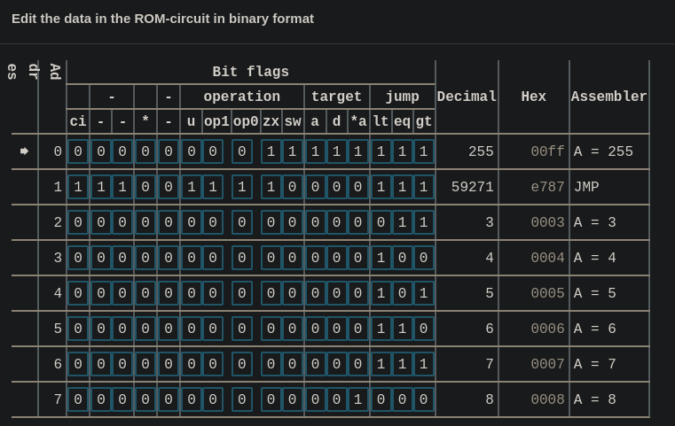
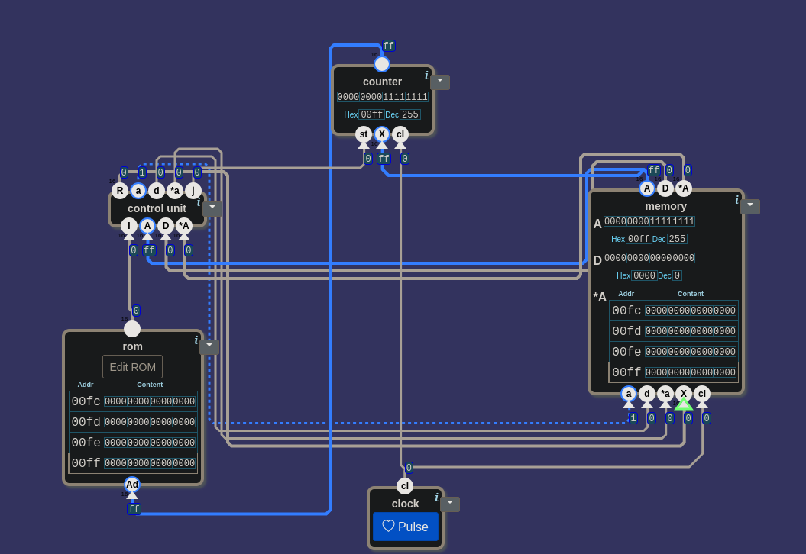

# 🧮 From Switches to a Computer — Computer: A Machine With No Inputs

> In this level the canvas had no inputs and no outputs. The first reaction was:
> *"They stole the input and the output!"* If nobody writes anything from the
> outside, where would the machine learn what to do? The answer was in a single
> sentence in the middle of the window. The question "who is counting what?" led
> back to 20. A part that was looked for and wasn't in the toolbox exposed a piece
> of extra work. The first Check was failed by a two-line program; when that
> program was run by hand, step by step, the bug came down to a single wire.

---

## 📋 Table of Contents

- [What Does This Part Do?](#what-does-this-part-do)
- [No Inputs, So Where Do Instructions Come From?](#no-inputs-so-where-do-instructions-come-from)
- [Two Memories](#two-memories)
- [Who Is Counting What?](#who-is-counting-what)
- [The Part That Wasn't in the Toolbox](#the-part-that-wasnt-in-the-toolbox)
- [The Loop Closes](#the-loop-closes)
- [The Game Runs a Program](#the-game-runs-a-program)
- [A or *A?](#a-or-a)
- [How Many Nands?](#how-many-nands)
- [21.5's Remaining Questions](#215s-remaining-questions)
- [🎮 Now You Build It](#-now-you-build-it)

---

## What Does This Part Do?

The fifth level of the Processor unit. Here's the scene:

```
inputs:     none
outputs:    none
toolbox:    nand · control unit · memory · inv · and · or · rom · counter · clock
```

Three familiar circuits are ready in the toolbox: the `control unit` you built in
[25](./25_control_unit.md), the `memory` you built in
[22](./22_combined_memory.md), and the `counter` you built in
[20](./20_counter.md). Two parts are new: `rom` and `clock`.

The level's definition:

> *"Build a computer by combining:*
>
> - *A control unit*
> - *Storage memory (RAM and registers)*
> - *A program memory unit (ROM).*
> - *A counter which keeps track of the current instruction address (called the
>   "program counter" or **PC**).*
> - *A clock unit*
>
> *The word at the PC address in the program memory is the `I` input to the
> control unit.*
>
> *Each clock cycle changes the program counter depending on `j`: If `j`=0, the
> program counter should advance with 1. If `j`=1, the PC should be set to the
> value on A."*

The window that opens:

> *"You have reached the final challenge. If you can complete this, you have built
> a working programmable microprocessor."*

Think of someone reading a recipe. Whatever line their finger is on, they do the
work on that line, then slide their finger down one line. If the line says "go
back to step 3," they move their finger to line 3. The machine in this level
behaves the same way:

| on each clock tick | where the finger goes |
|---|---|
| `j` = 0 | to the next line |
| `j` = 1 | to the line written in A |

`j` had been computed since [23](./23_alu_instruction.md#r-and-j), but it didn't go
anywhere. In Control Unit it was put like this: *"j says whether the result meets
the condition; there's no jumping in this level."* In this level there is.

---

## No Inputs, So Where Do Instructions Come From?

The canvas says `Output:` at the top and `Input:` at the bottom, but there's
nothing next to either. In every level so far you gave the inputs values by hand.
Here there's no input to give.

The question was: *If nobody writes anything from the outside, where does the
machine learn what to do on each clock tick?*

The answer is in the sentence in the middle of the definition: *"The word at the
PC address in the program memory is the `I` input to the control unit."* It was put
like this: *"The word at the PC address in the program memory (rom)… the
control unit's input."*

The instructions don't come from the outside; they sit in `rom`. The first wire
came from here:

```
rom's output  →  control unit's I
```

> 🔑 **This computer has no inputs; it has a program.** On every tick it reads what
> to do from its own memory.

---

## Two Memories

After that sentence a doubt came up: had rom and memory been mixed up? There are
two separate "memories" in the toolbox:

| | `rom` | `memory` |
|---|---|---|
| what's inside | instructions | numbers: A, D and RAM |
| can it be written? | no; it has a single input at the bottom, `Ad` | yes; it has write inputs at the bottom: `a`, `d`, `*a`, `X`, `cl` |
| in the recipe | the recipe book | the counter top: where the work is laid out |

A question followed: *"Isn't there anything going from RAM to rom?"* Not directly.
Rom's only input is `Ad`; it has no leg for writing data into it. Rom is only read.
The recipe book doesn't change while you cook.

While looking at memory, another question came up: *"What was D for again?"* A
short reminder: to look at another RAM cell, A is moved, and the number in A is lost
at that moment. D is the second register that holds a number while A moves
([22](./22_combined_memory.md#a-is-both-data-and-address)).

---

## Who Is Counting What?

What should go into rom's `Ad`? The definition says: *"the word at the PC
address."* `Ad` should get a line number. The part that holds the line number is in
the definition's fourth bullet: *"a counter which keeps track of the current
instruction address."* Its name in the toolbox is `counter`.

The first reaction: *"Counter?… Who is counting what?"* To answer it,
[20](./20_counter.md#what-does-this-part-do) was opened again. The definition
there:

> *"A counter component increments a 16-bit number for each clock cycle. If `st`
> (store) is 1, then the input value `X` is used as the new counter value. If
> `st` is 0, then the previous counter value is incremented by 1. The counter
> output changes when `cl` (clock signal) changes to 0."*

In this level, what the counter counts is the line number. Its output goes to
`Ad`:

```
counter's output  →  rom's Ad
```

Now put the two tables side by side:

| counter (20) | written | | finger (this level) | goes to |
|---|---|---|---|---|
| `st` = 0 | output + 1 | | `j` = 0 | the next line |
| `st` = 1 | `X` | | `j` = 1 | the line written in A |

On the left, `st` picks one of the two rows; on the right, `j` does. The
connection came out of the table: **`j` → `st`**.

One more thing was noticed: *"X was a ready-made candidate given from the outside;
now this X will come from this circuit."* In 20 you gave `st` and `X` by hand.
Here the circuit produces both itself. The rule from
[21.5](./21.5_sayi_mi_komut_mu.md#wires-from-the-outside): every level takes some of
the previous level's outside inputs inside.

---

## The Part That Wasn't in the Toolbox

What should go into `X`? The first answer was `*A`. Then a plan followed: when
`st` = 0, "the next line" has to come from somewhere too, maybe from `*A`. Then a
`select 16` would go in front of `X` and pick between A and `*A`.

But there was no `select 16` in the toolbox. While the plan was being talked
through out loud, this was noticed: *"X is only read when st is 1."*

Look at the table from 20: `X` doesn't appear in the `st` = 0 row. The counter
finds the next line by itself: output + 1. `X` is only looked at at the moment of a
jump. There's only one candidate, so a selector is unnecessary. That candidate is
in the definition's last sentence: *"If `j`=1, the PC should be set to the value on
A."* So `X` ← A.

> 💡 **If the part you're looking for isn't in the toolbox, read the table again.**
> Is there really a need for something that does that job? Here there wasn't: `X`
> isn't read at all while `st` = 0.

---

## The Loop Closes

The `clock`'s `cl` went to two places: the `cl` of the counter and of memory.
These are the two parts that store something. The `control unit` stores nothing,
and `rom` isn't written; neither of them has a `cl` input.

After these connections, this was said: *"Right now there's a loop inside it."*

What was left was the control unit's R. In earlier levels R went to an output; here
there are no outputs. In [25](./25_control_unit.md#read-value-write-permission)
this sentence had been said: *"Uppercase is the read value, lowercase is the write
permission."* `a`, `d` and `*a` give the "write here" permission. The value to be
written is in R. The input on memory that waits for that value is `X`
([22](./22_combined_memory.md#what-does-this-part-do)):

```
control unit's R           →  memory's X
control unit's a, d, *a    →  memory's a, d, *a
memory's A, D, *A          →  control unit's A, D, *A
```

The result of the calculation is written back into memory, and the values in memory
go back into the calculation. All together:

```
   ┌──────────────────────── X ← A ─────────────────────────┐
   │  ┌───────── st ← j ──────────┐                         │
   ▼  ▼                           │                         │
 counter ──Ad──► rom ──I──► control unit ──R, a, d, *a──► memory
                                    ▲                       │
                                    └────── A, D, *A ───────┘
```

The `clock`'s `cl` goes to the counter and to memory.

---

## The Game Runs a Program

The first Check failed:


> *"Testing with this program in ROM:"*
>
> | Address | Instruction |
> |---|---|
> | 0 | `00ff` |
> | 1 | `e787` |
>
> *"Steps performed: Executing instruction 00FF. This should cause the value 00FF
> to be written to the A register. Clock cycle. Executing instruction E787. This
> should cause the value of A (00FF) to be written to PC. Clock cycle. The ROM
> address was expected to be 00FF but was 0000."*

In earlier levels the game tested rows one by one. Here it runs a two-line program.
`00ff` (255) is a data instruction: bit 15 = 0, write 255 into A. `e787` is an ALU
instruction; its last three bits are `111`, so the condition is true for every
number: `j` = 1, jump.

The same program was run by hand. The `Edit ROM` button on rom opens an editor;
every bit is a box, and the names of the bits are written above the columns:

| | ci | - | - | * | - | u | op1 | op0 | zx | sw | a | d | *a | lt | eq | gt |
|---|:-:|:-:|:-:|:-:|:-:|:-:|:-:|:-:|:-:|:-:|:-:|:-:|:-:|:-:|:-:|:-:|
| `00ff` | 0 | 0 | 0 | 0 | 0 | 0 | 0 | 0 | **1** | **1** | **1** | **1** | **1** | **1** | **1** | **1** |
| `e787` | **1** | **1** | **1** | 0 | 0 | **1** | **1** | **1** | **1** | 0 | 0 | 0 | 0 | **1** | **1** | **1** |


*`00ff` and `e787` in the editor's `Hex` column. The rightmost column writes the short name of the instructions: `A = 255` and `JMP`.*

> 🔑 **The `Hex` column is your cross-check.** After entering the bits you should see
> `00ff` in row 0 and `e787` in row 1. If you see something else, a bit was
> entered wrong.

Pressing the `Pulse` button on `clock` once is one clock cycle. Expected:

| when | counter | memory's A |
|---|:-:|:-:|
| at the start | 0 | 0 |
| after the 1st Pulse | 1 | `00ff` (255) |
| after the 2nd Pulse | **`00ff` (255)** | `00ff` (255) |

After the 1st Pulse the counter was 1 and A was `00ff`: same as the table. Before
pressing the 2nd Pulse, everything was stopped and looked at. `I` = `e787`, `j` =
1, the counter's `st` is 1. On the next tick the counter will write whatever is in
`X`. `X` held 0:


*After the 1st Pulse. Counter 1, memory's A `00ff`, `I` = `e787`, `st` = 1. The counter's `X` holds 0.*

`X`'s wire was followed: it was connected to memory's `*A`. The idea had been
corrected to "`X` ← A", but the wire was still on the first idea. Only the test
showed that.

> 🔑 **If the result is wrong, run the program step by step.** The game only tells
> you the final state: 0000. Stopping after every tick to look brings the bug down
> to a single wire.

---

## A or *A?

While the wire was being moved, a question was asked: *"But why did we first say
memory's *A for X?"*

The sentence "jump to the line A points to" sounds like `*A`, because "points to"
is exactly the description of `*A`. But they are two different things:

| | what | in the test |
|---|---|---|
| A | a number; here, a line number | `00ff` (255) |
| `*A` | the value sitting in RAM cell number A | RAM cell `00ff` is empty: 0 |

To jump you need a line number, which is A. `*A` is the value inside a cell on the
counter top; it has nothing to do with rom's lines. In the test that cell was
empty: `X` became 0, and the counter went back to 0. That's what the game saw:
*"was 0000."*

In [22](./22_combined_memory.md#a-is-both-data-and-address) A had two jobs: holding
a number and pointing RAM at an address. In this level A gives an address to a
second memory as well:

```
A  →  to RAM, directly:                    *A
A  →  to rom, indirectly, at a jump:       X → counter → Ad
```

Memory isn't connected to rom directly. But at the moment of a jump, A decides
through the counter which line rom will read.

Once the wire was moved to A, the two steps were run again. After the 2nd Pulse the
counter showed `00ff`, and Check passed.

---

## How Many Nands?

The game's answer:

> *"4 components used. (Not counting clock which does not contain any logic.) 5346
> nand gates in total. And 161792 for each kilobyte of RAM. (ROM storage not
> counted) This is the simplest possible solution!"*

| part | nands | lesson where it was built |
|---|:-:|---|
| `control unit` | 3934 | [25](./25_control_unit.md) |
| `counter` | 996 | [20](./20_counter.md) |
| `memory` | 416 (+ 161792 for each kilobyte of RAM) | [22](./22_combined_memory.md) |
| `rom` | 0 (storage not counted) | — |
| `clock` | not counted: no logic inside | — |
| **total** | **5346** | |

3934 + 996 + 416 = 5346.

> 🔑 **This level didn't add a single new gate.** The computer came out of wiring
> together parts built in earlier lessons.

---

## 21.5's Remaining Questions

At the end of [21.5](./21.5_sayi_mi_komut_mu.md#entering-the-processor) three
questions were left. The second was answered in
[23](./23_alu_instruction.md#one-of-three-questions-answered). The remaining two
closed in this level:

**1.** *To read commands lying one after another in memory **in order**, which number
needs to be held, and by whom?* The line number, the PC, is held by the
`counter`. It goes up by 1 on every tick and takes A at a jump.

**3.** *Does `cl` keep coming from outside until the end of the unit?* In this
level there are no outside inputs at all. `cl` comes from the `clock` box in the
toolbox. The game doesn't count it: *"does not contain any logic."* It still isn't
the output of any gate.

---

## 🎮 Now You Build It

Parts list: **1 × `control unit`**, **1 × `memory`**, **1 × `rom`**,
**1 × `counter`**, **1 × `clock`**.

When you're done, count the input legs: `rom` 1, `control unit` 4, `memory` 5,
`counter` 3, **13** in total. `clock` has no inputs.

### How to test it

With `Edit ROM`, write `00ff` into row 0 and `e787` into row 1 (the bits are in the
table above). Cross-check with the `Hex` column. Then press `Pulse` once at a time,
and stop and look after each press:

| step | when | `I` | counter | counter's `X` | memory's A | what's being tested |
|---|---|:-:|:-:|:-:|:-:|---|
| 1 | at the start | `00ff` | 0 | 0 | 0 | rom's row 0 is in `I` |
| 2 | after the 1st Pulse | `e787` | 1 | `00ff` | `00ff` (255) | data instruction wrote to A; `j` = 0 → next line |
| 3 | after the 2nd Pulse | `0000` | `00ff` (255) | `00ff` | `00ff` | `j` = 1 → PC ← A |

The `X` in step 2 is the most important thing to look at in this level: it shows
the value the counter will write before the jump.

<details>
<summary>🔑 If you're stuck — connection list</summary>

```
rom:            Ad ← counter's output
control unit:   I ← rom's output
                A ← memory's A    D ← its D    *A ← its *A
memory:         X ← control unit's R
                a ← its a    d ← its d    *a ← its *a
                cl ← clock
counter:        st ← control unit's j
                X ← memory's A
                cl ← clock
```

</details>


*The passing circuit, after two Pulses. The counter is at `00ff`; `X` ← memory's A.*


*4 components, 5346 nands. Next comes the last level of the Processor unit: Input and Output.*

---

## Summary — Keep in Mind

```
☐ Computer: control unit + memory + rom + counter + clock. No outside inputs or outputs.
☐ 🔑 This computer has no inputs; it has a program: the word at the PC address in rom → the control unit's I.
☐ Two memories: rom = instructions, read only (single input Ad) · memory = A, D, RAM, writable.
☐ Nothing writes to rom. Only a line number goes into Ad.
☐ PC = counter: it holds the line number. counter → rom's Ad.
☐ counter (20) ↔ finger: st = 0 → +1 ↔ j = 0 → next line · st = 1 → X ↔ j = 1 → the line in A. So j → st.
☐ st and X, given by hand in 20, come from inside the circuit here.
☐ X is only read while st = 1 → no selector needed. 💡 If the part you want isn't in the toolbox, read the table again.
☐ clock → the cl of the counter and of memory: the two parts that store something.
☐ R → memory's X; a, d, *a are write permissions; A, D, *A go back to the control unit. The loop is closed.
☐ The game now tests with a program: 00ff (A = 255), e787 (JMP).
☐ 🔑 The Hex column is your cross-check. One Pulse = one clock cycle.
☐ 🔑 If the result is wrong, run the program step by step: the bug comes down to a single wire.
☐ At a jump X ← A, not *A. A = the line number, *A = the value in that RAM cell.
☐ A gives an address to two memories: to RAM directly (*A), to rom at a jump through the counter.
☐ An idea corrected in your head may not be corrected on the canvas. The test shows that.
☐ Solution: 4 components, 5346 nands = 3934 + 996 + 416. This level added no new gates.
```

---

## 🔗 Related Topics

- [25_control_unit.md](./25_control_unit.md) — Data instruction and ALU instruction; read value, write permission
- [23_alu_instruction.md](./23_alu_instruction.md) — `j`: the condition bits
- [22_combined_memory.md](./22_combined_memory.md) — A is both data and address; memory's inputs
- [21.5_sayi_mi_komut_mu.md](./21.5_sayi_mi_komut_mu.md) — Outside inputs get taken inside; where `cl` comes from
- [20_counter.md](./20_counter.md) — `st` and `X`; output + 1

---

**Previous topic:** [25_control_unit.md](./25_control_unit.md)
**Next topic:** [27_input_and_output.md](./27_input_and_output.md)

*This lesson is part of the "From Switches to a Computer" series. The series moves along together with [nandgame.com](https://nandgame.com).*
