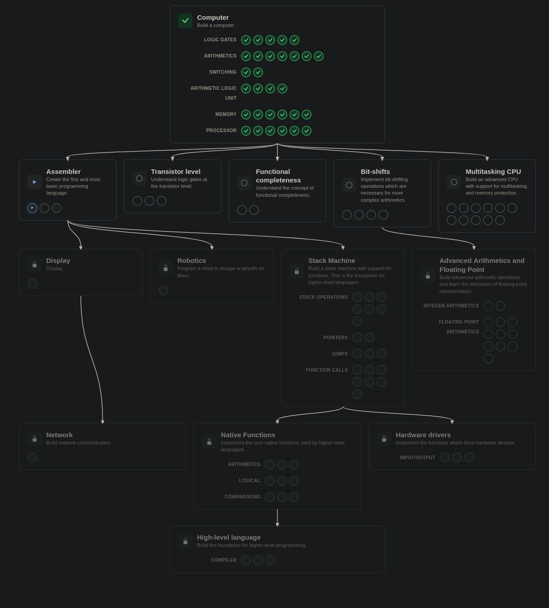

# 🗺️ From Switches to a Computer — Interlude: What Can't This Machine Do?

> The Processor unit is done. The thirty levels in NandGame's "Computer" box closed
> along with it. A staircase that began with a switch stopped at a machine that
> reads its own program. This interlude stands in front of that machine and asks a
> single question:
>
> **What can't this machine do?**

> The whole claim of this lesson in one sentence:
>
> **Every gap in the machine you built is a question, and every question is a branch
> in NandGame. Put the questions side by side and the map of the next parts appears.**

> *(Interlude: no circuit, no new level. The close of Part 1.)*

---

## 📋 Table of Contents

- [What Did We Build?](#what-did-we-build)
- [What Can't This Machine Do?](#what-cant-this-machine-do)
- [The Map](#the-map)
- [What Stays in NandGame, What Goes Beyond](#what-stays-in-nandgame-what-goes-beyond)

---

## What Did We Build?

Thirty levels, seven units. Every floor was built from the one below it:

```
   PROCESSOR        reads commands, runs them, touches the outside   22–27
       ▲
   MEMORY           circuits that hold a bit, a number, an address   16–21
       ▲
   ALU              the arithmetic core                              12–15
       ▲
   DECISIONS        flags and selectors                              10–11
       ▲
   LIMITS           overflow and negative numbers                    08–09
       ▲
   COUNTING         giving wires a number meaning, adders            04–07
       ▲
   BRICKS           the switch, the nand and every gate              01–03
```

You built the machine at the top in [26](./26_computer.md): it has no inputs, it has
a program. It reads the program from rom line by line and runs one command on every
ring of the bell. In [27](./27_input_and_output.md) it touched the outside world
through an address: it lit a lamp and read a button.

By the game's count this computer is **5346 nands**, not counting RAM
([26 → How Many Nands?](./26_computer.md#how-many-nands)).

> 🔑 **Thirty levels and not a single new kind of gate.** Everything is the same
> brick repeated: the nand from [01](./01_akim_salter_role.md).

---

## What Can't This Machine Do?

The machine works. But when you look at it, some questions come on their own. Their
answers are not here: each one is answered in a branch of NandGame.

### 1. It can't shift, multiply or hold a fraction

In [14](./14_alu.md#eight-rows-32-states) you counted every operation the ALU can do:
nineteen. None of them shifts the bits of a number left or right, and none of them
multiplies. The numbers are always read as whole numbers, too: read unsigned they run
from 0 to 65535, read in two's complement from −32768 to 32767. Neither agreement has
a pattern for 0.5.

> **Question:** What does a circuit that shifts bits or multiplies two numbers need?
> By which agreement would you write a number like 0.5 into 16 bits?
>
> **Branch:** Part 1.1 · Bit-shifts → Part 1.2 · Advanced Arithmetics + Floating Point

### 2. It runs one program at a time

The machine in 26 has a single PC: it reads a single program from rom, line by line.
If the program falls into an endless loop, the machine runs it forever. And any
command can write to any number in memory.

> **Question:** How do two programs take turns on the same machine? What does it take
> so that one cannot wreck the other's memory?
>
> **Branch:** Part 1.3 · Multitasking CPU

### 3. We write programs in bits

In [26](./26_computer.md#the-game-runs-a-program) you wrote the game's test program
into rom bit by bit. The editor's rightmost column showed the same lines by their
short names: `A = 255` and `JMP`. The machine cannot read those short names; it only
reads the 16 bits.

> **Question:** When you write `A = 255`, who turns it into 16 bits? What does a
> program need to jump from its middle to another part and come back? And in the end,
> who translates a line written in a language people can read into the machine's
> language?
>
> **Branch:** Part 1.4 · Assembler → 1.5 · Stack Machine → 1.6 · Native Functions →
> 1.7 · High-level language

### 4. Outside, there is only a lamp and a button

In 27 a lamp and a button were attached to an address: the lamp is written to, the
button is read from.

> **Question:** Does a screen with thousands of dots, a robot trying to escape a
> labyrinth on Mars, or a line talking to another machine attach the same way? Who
> writes the code that drives a device?
>
> **Branch:** Part 1.4|1 · Display → 1.4|1.1 · Network · Part 1.4|2 · Robotics ·
> Part 1.5|1 · Hardware drivers

### 5. The nand is a closed box

The whole series used the nand as a ready-made box. In
[01.5](./01.5_yasak_bolge.md#cmos-why-in-pairs) you saw that a NOT gate is built from
one p-type and one n-type transistor: one connects the output to 1, the other to 0,
and the two never conduct at the same time.

> **Question:** How is a nand gate built from transistors?
>
> **Branch:** Part -1 · Transistor level

### 6. Why the nand?

In [02](./02_nanddan_kapilar.md) you derived not, and and or from a single nand. The
series built every floor on top of that one brick.

> **Question:** Is that something special about the nand? Can everything also be
> built from nor, or from and together with not?
>
> **Branch:** Part 1|1 · Functional completeness

---

## The Map

When Part 1 was done, this sentence was said: *"The Computer part is done, so the
beginning is done."* Put the branches of the six questions side by side and this map
is drawn on top of that beginning:

```
🔒 1.7    High-level language
   │
🔒 1.6    Native Functions
   │
🔒 1.5    Stack Machine ──────────── 🔒 1.5|1   Hardware drivers
   │
🔒 1.4    Assembler ─────────────┬── 🔒 1.4|1   Display
   │                             │      └── 🔒 1.4|1.1  Network
   │                             └── 🔒 1.4|2   Robotics
   │
   ┄┄┄┄┄┄┄┄  above: writing programs · below: building circuits  ┄┄┄┄┄┄┄┄
   │
🔒 1.3    Multitasking CPU
   │
🔒 1.2    Advanced Arithmetics + FP
   │
🔒 1.1    Bit-shifts
   │
✅ 1      From Switches to a Computer ── 🔒 1|1   Functional completeness
   │
🔒 -1     Transistor level
```

How to read the numbers:

- `1.x`: up, toward software (1.4 Assembler)
- `-x`: down, into the nand (-1 Transistor level)
- `x|y`: a side branch coming out of that part (1.4|1 Display)

✅ written, 🔒 not written yet. The main line will be written in this order: first
1.1–1.3, which means still building circuits and growing the machine from Part 1.
Above the dashed line, from 1.4 on, we stop building circuits and start writing
programs for that machine. Side branches and -1 come after the part they hang from.

> 💡 The part names are in English as in NandGame, so you can find the branch in the
> game easily.

NandGame's own tree:


*At the top, the Computer box we finished. Five branches open below it; the locked
ones open once the branch above them is done.*

---

## What Stays in NandGame, What Goes Beyond

This series follows NandGame. Every part on the map is a box in the game, and every
lesson is a level or an interlude.

Some branches touch topics that reach outside the game. In 1.4, NandGame will have
you build an assembly language for its own machine. That language belongs to this
machine, and the lessons will cover it. The assembly of a real processor is a
different topic: it does not mix into these lessons, it gets its own heading.

> 🔑 **What NandGame teaches stays in NandGame. A topic that goes beyond the game gets
> its own heading.**

Part 1's lessons end here. The next parts will start in their own folders, each with
its own `01`. The first lesson of Part 1.1 is the first level of the Bit-shifts
branch: **Left Shift**.

---

## Summary — Keep in Mind

```
☐ Part 1 = NandGame's "Computer" box: thirty levels, 01–27 plus the interludes.
☐ The computer in 26 is 5346 nands, not counting RAM. Thirty levels, no new kind of gate: it is all nand.
☐ 🔑 Every gap in the machine is a question, and every question is a branch in NandGame.
☐ Shifting, multiplying, fractions → 1.1 Bit-shifts, 1.2 Advanced Arithmetics + Floating Point.
☐ One program, unprotected memory → 1.3 Multitasking CPU.
☐ Programs written in bits → 1.4 Assembler. Jumping to a part and back, and a language → 1.5, 1.6, 1.7.
☐ Devices bigger than a lamp and a button → 1.4|1 Display, 1.4|1.1 Network, 1.4|2 Robotics, 1.5|1 Hardware drivers.
☐ Inside the nand → -1 Transistor level. Why the nand → 1|1 Functional completeness.
☐ Numbers: 1.x up (toward software), -x down (into the nand), x|y a side branch.
☐ The main line is written in this order: 1.1–1.3 are still circuits, programs from 1.4 on.
☐ 🔑 What NandGame teaches stays in NandGame. A topic that goes beyond the game gets its own heading.
```

---

## 🔗 Related Topics

- [26_computer.md](./26_computer.md) — The machine itself; 5346 nands; a program written into rom bit by bit
- [27_input_and_output.md](./27_input_and_output.md) — A lamp and a button through an address
- [14_alu.md](./14_alu.md) — The ALU's nineteen operations
- [02_nanddan_kapilar.md](./02_nanddan_kapilar.md) — Every gate from a single brick
- [01.5_yasak_bolge.md](./01.5_yasak_bolge.md) — The transistor and CMOS
- [00_buradan_basla.md](./00_buradan_basla.md) — Part 1's lesson-by-lesson map

---

**Previous topic:** [27_input_and_output.md](./27_input_and_output.md)
**Next topic:** Part 1.1 · Bit-shifts *(on the way)*

*This lesson is part of the "From Switches to a Computer" series. The series moves along together with [nandgame.com](https://nandgame.com).*
