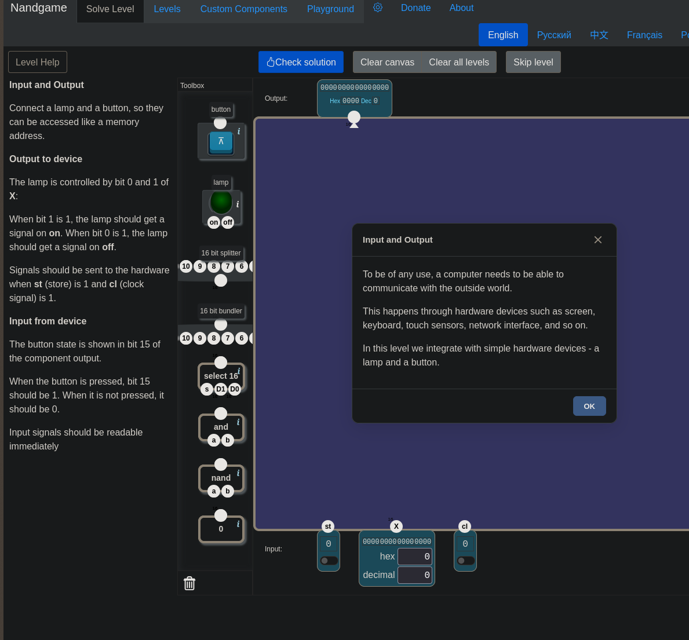
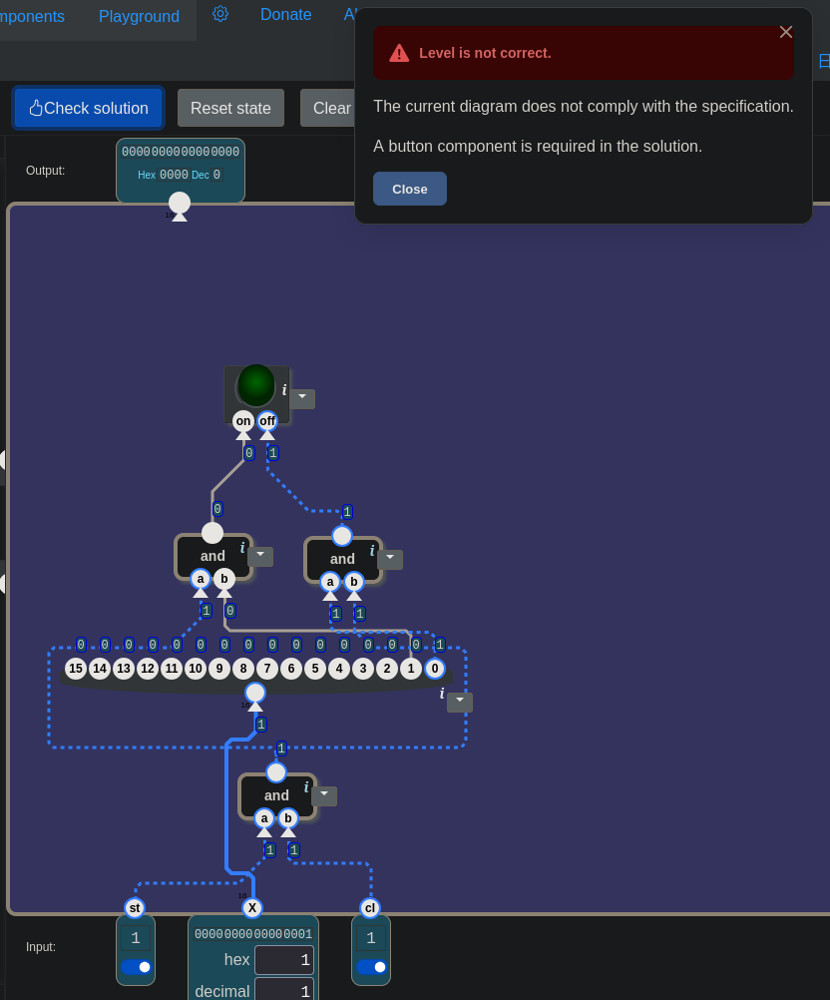
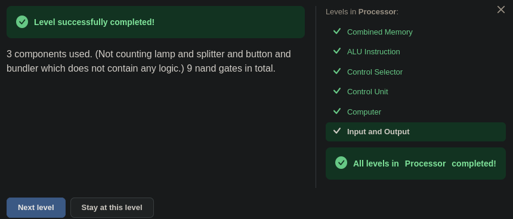
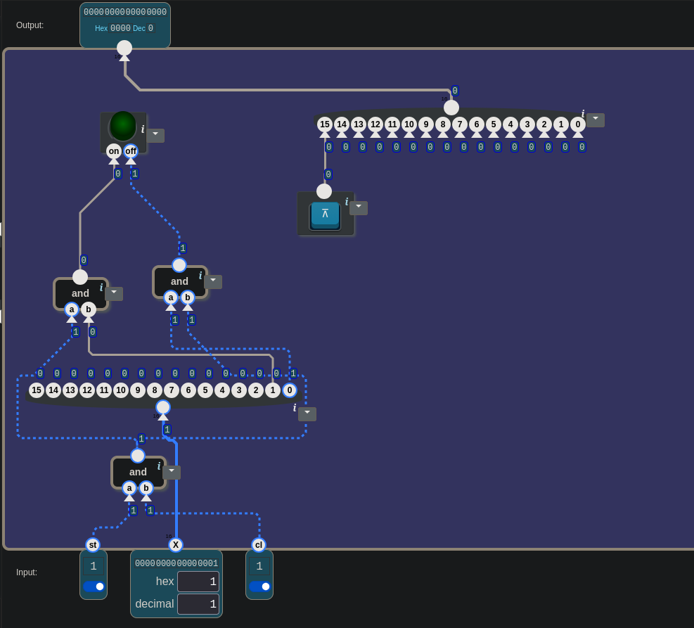

# 🧮 From Switches to a Computer — Input and Output: A Lamp That Looks Like an Address

> The first idea was this: when the button is pressed, the clock starts running
> and the lamp lights up. But the button and the lamp were never connected to each
> other. When the button was plugged into a splitter, the rightmost bit lit up
> instead of bit 15. Three `and`s computed the same thing three times. "X = 1"
> didn't turn the lamp on, it turned it off. On the first Check the game didn't
> object to the lamp; it said the button was missing altogether. And after the
> level passed, the real question was still there: if the button is something
> coming in from the outside, why does it go to "Output"?

---

## 📋 Table of Contents

- [What Does This Part Do?](#what-does-this-part-do)
- [The Button Doesn't Light the Lamp](#the-button-doesnt-light-the-lamp)
- [Splitter Opens, Bundler Gathers](#splitter-opens-bundler-gathers)
- [The Mail Carrier Has Come](#the-mail-carrier-has-come)
- [Which Bit Lights Up When X Is 1?](#which-bit-lights-up-when-x-is-1)
- [Forgetting the Button](#forgetting-the-button)
- [Whose Output Is "Output"?](#whose-output-is-output)
- [How Many Nands?](#how-many-nands)
- [Two Open Questions](#two-open-questions)
- [The Processor Unit Is Done](#the-processor-unit-is-done)
- [🎮 Now You Build It](#-now-you-build-it)

---

## What Does This Part Do?

The sixth and last level of the Processor unit. Here's the scene:

```
inputs:   st (1 bit) · X (16 bits) · cl (1 bit)
output:   16 bits
box:      button · lamp · 16 bit splitter · 16 bit bundler · select 16 · and · nand · 0
```



The pop-up window:

> *"To be of any use, a computer needs to be able to communicate with the outside
> world. This happens through hardware devices such as screen, keyboard, touch
> sensors, network interface, and so on. In this level we integrate with simple
> hardware devices - a lamp and a button."*

The level's definition:

> *"Connect a lamp and a button, so they can be accessed **like a memory
> address**.*
>
> ***Output to device:** The lamp is controlled by bit 0 and 1 of X: When bit 1 is
> 1, the lamp should get a signal on **on**. When bit 0 is 1, the lamp should get
> a signal on **off**. Signals should be sent to the hardware when `st` (store) is
> 1 and `cl` (clock signal) is 1.*
>
> ***Input from device:** The button state is shown in bit 15 of the component
> output. When the button is pressed, bit 15 should be 1. When it is not pressed,
> it should be 0. Input signals should be readable **immediately**."*

Picture a mailbox. You leave a note for the lamp: "turn on" or "turn off". The
note only gets delivered when the mail carrier comes. There's also a flag on top
of the box. Someone outside raises the flag; anyone who looks at it sees it at
any moment, without waiting for the mail carrier.

The wanted behavior is two tables:

| `st` | `cl` | what does the lamp get? |
|:-:|:-:|---|
| 0 | anything | nothing |
| 1 | 0 | nothing |
| 1 | 1 | **on** if bit 1 of X is 1, **off** if bit 0 is 1 |

| button | bit 15 of the output | when |
|---|:-:|---|
| pressed | 1 | immediately |
| not pressed | 0 | immediately |

---

## The Button Doesn't Light the Lamp

The first idea went like this: *"When we press the button, the clock pulses will
be activated, they'll gain a meaning. But whether the lamp stays on or off has to
be stored with st."*

One half of it is right: writing to the lamp means changing the lamp's state,
and that's where the `st` and `cl` condition comes from. In the other half, two
things got mixed up.

First, the button doesn't light the lamp. The definition is clear: *"The lamp is
controlled by bit 0 and 1 of X."* X lights the lamp, meaning the program inside
the computer. The person outside presses the button, and the computer reads it.
The two devices point in opposite directions:

```
lamp   :  computer ──► outside      (writing)
button :  outside ──► computer      (reading)
```

Second, `cl` doesn't come when the button is pressed. In
[26](./26_computer.md#the-loop-closes), `cl` came from the `clock` box in the
toolbox. The clock runs whether the button is pressed or not.

> 🔑 **There are two separate devices in this level, with no wire between them.**
> The lamp goes from the computer to the outside, the button from the outside to
> the computer.

---

## Splitter Opens, Bundler Gathers

While building the button's path, a splitter was tried first: *"I'm pressing the
button. Not the 15th, the 1st bit lights up. I'm confused."*

A splitter **opens** a 16-bit wire into individual bits. The button, though,
gives a single-bit signal. The game read that single bit as a 16-bit number: its
value is 1. And the number 1 sits in the rightmost bit. That was the bit that lit
up.

In the same message, the direction turned around on its own: *"Or I'll take the
bundler, connect it to the 15th bit and use the bundler's output."* A bundler
does the opposite: it **gathers** individual bits and puts out a 16-bit wire.
Whichever leg the button is plugged into, the signal sits in that bit.

```
bit:  15  14  13  …  2   1   0
       ▲                     ▲
   the button            the one that lit
   belongs here          up in the splitter
```

The bit called "the 1st bit" was actually bit 0. The same mix-up happened in
[23](./23_alu_instruction.md#12th-bit-and-bit-12): bits are numbered from right
to left, starting at **0**. The "first bit" is named bit 0, the leftmost one is
named bit 15.

| part | goes in | comes out |
|---|---|---|
| `16 bit splitter` | a single 16-bit wire | 16 separate bits |
| `16 bit bundler` | 16 separate bits | a single 16-bit wire |

---

## The Mail Carrier Has Come

Before moving on to the lamp side, a question was asked: *"The st and cl
condition is needed for the lamp to go on and off, right? Not only for on."* Yes.
The condition is set for the lamp itself, it applies to both of its inputs. Until
the mail carrier comes, neither a "turn on" nor a "turn off" note drops into the
box.

The first circuit built was this:


*The first try. Both bottom `and`s get `st` and `cl`, the top one takes their outputs. X isn't connected anywhere.*

Reading the wires:

```
left and   =  st AND cl
right and  =  st AND cl                   ← the same two wires
top and    =  (st AND cl) AND (st AND cl)  =  still st AND cl
```

Three gates were doing the job of a single `and`. When asked what the actual plan
was: *"At first I was going to have select 16 choose. If both are 1, I'd hand it
out to the lamp's on and off."*

The sentence "if both are 1" is the definition of `and`. `select 16` asks a
different question: which of two pieces of data should I pass? `D0` if `s` = 0,
`D1` if `s` = 1. It doesn't ask "are both 1?" Here there's no choosing between
two pieces of data; there's a single permission:

```
st ──┐
     and ──►  "the mail carrier has come"
cl ──┘
```

The next question: the mail carrier has come; what else is needed for a signal to
go to on? The answer: *"An and again, right? The one from X and the output of the
first and."*

In [15](./15_condition.md#and-as-a-valve), `and` was used as a valve: if the
permission is 0 it passes nothing, if the permission is 1 it passes the value on
the wire unchanged. Here the permission is the "mail carrier has come" wire, and
the value being passed is one bit of X. On and off are two separate valves; the
same permission wire goes to both.

> 🔑 **"If both are 1" is an `and`, not a selector.** A selector passes one of two
> pieces of data; an `and` uses a permission to pass or hold a single value.

---

## Which Bit Lights Up When X Is 1?

There was a sentence in the plan: *"x = 1 and st = 1, cl = 1 meets the
condition."* But "X = 1" doesn't mean "the on bit is 1". X is a 16-bit number.
When you type decimal 1 on the screen:

```
X = 1   →   0000 0000 0000 0001   →   bit 0 = 1   →   OFF
X = 2   →   0000 0000 0000 0010   →   bit 1 = 1   →   ON
```

Writing 1 to X tells the lamp "turn off". To turn it on, X = 2.

An `and`'s input is one bit, X is 16 bits. How do you pull only bit 1 out of X?
The answer was one word: *"Splitter."*

```
X ──► splitter ──► bit 1 ──┐
                           and ──► lamp ON
"mail carrier has come" ───┘

X ──► splitter ──► bit 0 ──┐
                           and ──► lamp OFF
"mail carrier has come" ───┘
```

One output can go to more than one place. The "mail carrier has come" wire was
handed out to both valves.

> ⚠️ **"X = 1" is a number, "bit 1 = 1" is a wire.** The bit that lights up at
> decimal 1 is bit 0. The number that lights bit 1 is 2.

---

## Forgetting the Button

With the lamp built, Check was pressed:


*X = 1, `st` = 1, `cl` = 1. 0 goes to the lamp's on, 1 goes to its off. The game's objection isn't about the lamp.*

> *"Level is not correct. The current diagram does not comply with the
> specification. A button component is required in the solution."*

The reaction: *"Damn, I forgot the button."* The values on the screen showed that
the lamp side was right: at X = 1, "mail carrier has come" is 1, the `and` going
to on is 0, the `and` going to off is 1. The button was added:

```
button ──► bundler's bit 15 ──► Output
```

The second Check passed.

> 💡 **Read the game's error message to the end.** "Level is not correct" doesn't
> say everything is wrong. This time it only said one part was missing.

---

## Whose Output Is "Output"?

After the level passed, one question remained: *"What is the button for, that it
goes to Output? When I give X another value, the free outputs turn 1, but nothing
happens."*

The word choice is what's confusing. The button is an **input** coming into the
computer from the outside, yet on the canvas it's connected to the spot labeled
"Output". That's because this "Output" isn't the outside world's; it's the box's
output, and it goes to the processor. The box built in this level sits between
the processor and the outside world:

```
               PROCESSOR  (the Computer built in 26)
      to write   │ st, X, cl            ▲ to read
                 ▼                      │ "Output"
     ┌─────────────────── this level's box ──────────────────┐
     │  lamp ◄── st·cl + bit 1/0      button ──► bit 15        │
     └───────────────────────────────────────────────────────┘
                 │                      ▲
                 ▼                      │
            an eye outside        a finger outside
```

The **Input** at the bottom of the canvas (`st`, `X`, `cl`) comes from the
processor. The **Output** at the top goes to the processor. The button's job is
this: the program reads this box, looks at bit 15, and decides based on whether
the button is pressed.

That's where the sentence "like a memory address" comes from. Compare the box's
legs with the `register` box in
[22](./22_combined_memory.md#when-a-wire-is-left-loose):

| | `register` (22) | this level's box |
|---|---|---|
| inputs | `st` · `X` (16 bits) · `cl` | `st` · `X` (16 bits) · `cl` |
| output | 16 bits: the stored value | 16 bits: the button in bit 15 |
| writing | while `st` = 1, on the bell | while `st` = 1, on the bell (`cl` = 1) |

The processor writes to this box the way it writes to a register, and reads it
the way it reads a register. It doesn't need to know what a lamp or a button is.
To it, both are an address.

> 🔑 **The processor touches the outside world through an address.** Writing to
> the lamp is writing to an address, reading the button is reading an address.

As for the free bits: when X gets another value, the splitter's other outputs
turn 1 but nothing happens. That's a correct observation, and nothing should
happen. The lamp only listens to bit 0 and bit 1; the remaining 14 bits of X mean
nothing to this box.

> 🎮 **The game makes it easier here:** the bundler's 15 legs other than bit 15
> were left free, and the game counted them all as 0. The box in
> [22](./22_combined_memory.md#when-a-wire-is-left-loose): an unconnected input is
> 0 in the game. **In reality:** a floating input is not 0, its value is undefined. The
> toolbox also had a part called `0`; it wasn't used in this solution.

---

## How Many Nands?

The game's answer:

> *"3 components used. (Not counting lamp and splitter and button and bundler
> which does not contain any logic.) 9 nand gates in total."*

| part | count | counted? |
|---|:-:|---|
| `and` | 3 | yes: 9 nands in total |
| `lamp`, `button` | 1 each | no: devices |
| `16 bit splitter`, `16 bit bundler` | 1 each | no: no logic inside, just wires |

Here the game counts the `and` box as 3 nands: 9 ÷ 3. The note in
[18](./18_data_flip_flop.md) holds: don't guess how many nands the game counts
for a box, measure it.

> 🔑 **A splitter and a bundler are wire arrangements, not gates.** Opening or
> gathering a wire doesn't compute anything.

---

## Two Open Questions

**1.** Writing to the lamp changes the lamp's state; that's why `st` and `cl` are
waited for. Reading the button changes the state of what? Why can the input be
read "immediately"?

Hint: in [22](./22_combined_memory.md#lowercase-uppercase), lowercase was the
write permission and uppercase the read value. The same lesson describes the
memory like this: *"I'll write it there when the bell rings; and at every moment
I'll show A, D, and the RAM cell A points at."*

**2.** Why is the button in bit 15 and not in bit 0?

Hint: in [25](./25_control_unit.md#two-open-questions), bit 15 on its own was
worth 32768 (hex `8000`). For which numbers did `lt` in
[15](./15_condition.md#and-as-a-valve) become 1?

---

## The Processor Unit Is Done


*3 components, 9 nands. On the right: "All levels in Processor completed!"*

The unit's six levels:

| lesson | level | what was built |
|---|---|---|
| [22](./22_combined_memory.md) | Combined Memory | A, D and RAM in one box; A is both data and address |
| [23](./23_alu_instruction.md) | ALU Instruction | the instruction's bits were spread to the ALU and the condition |
| [24](./24_control_selector.md) | Control Selector | a single lever passes one of two packets as a whole |
| [25](./25_control_unit.md) | Control Unit | bit 15 tells the instruction's type: data or ALU |
| [26](./26_computer.md) | Computer | counter, rom, control unit and memory: the program runs on its own |
| 27 | Input and Output | the processor touches the outside world through an address |

---

## 🎮 Now You Build It

Parts list: **3 × `and`**, **1 × `16 bit splitter`**, **1 × `16 bit bundler`**,
**1 × `lamp`**, **1 × `button`**. `select 16`, `nand` and `0` are in the toolbox
but not used in this solution.

When you're done, count the connected input legs: the `and`s 3 × 2 = 6, the
splitter 1, the lamp 2, and on the bundler only bit 15: 1. **10** in total. Plus
the Output itself.

### How to test it

Look at the values on the wires going to the lamp's two inputs:

| step | `st` | `cl` | X | to on | to off | what's being tested |
|---|:-:|:-:|:-:|:-:|:-:|---|
| 1 | 1 | 1 | 2 | 1 | 0 | bit 1 → on |
| 2 | 1 | 1 | 1 | 0 | 1 | bit 0 → off; "X = 1" turns it off |
| 3 | 1 | 0 | 2 | 0 | 0 | the mail carrier hasn't come |
| 4 | 0 | 1 | 2 | 0 | 0 | nobody said store |

Then press the button: you should see `8000` in the Output's Hex box. Release it:
`0000`.

<details>
<summary>🔑 Stuck? — connection list</summary>

```
and 1:      a ← st                       b ← cl                → "mail carrier has come"
splitter:   input ← X
and 2:      a ← "mail carrier has come"  b ← splitter's bit 1
and 3:      a ← "mail carrier has come"  b ← splitter's bit 0
lamp:       on ← and 2                   off ← and 3
bundler:    bit 15 ← button
Output ← bundler
```

</details>


*The passing circuit. X = 1, `st` = 1, `cl` = 1: 1 goes to off, the lamp is dark. Top right: the button, from the bundler's bit 15 to Output.*

---

## Summary — Keep in Mind

```
☐ Input and Output: inputs st, X (16 bits), cl · output 16 bits · devices: lamp and button.
☐ 🔑 Two separate devices, no wire between them: the lamp from the computer to the outside (writing), the button from the outside to the computer (reading).
☐ X lights the lamp, not the button. cl comes from the clock, not the button.
☐ A splitter opens (16 bits → individual bits), a bundler gathers (individual bits → 16 bits).
☐ Bits are numbered from 0. The "first bit" = bit 0, the leftmost = bit 15.
☐ The st AND cl condition applies to on and to off: no note drops before the mail carrier comes.
☐ 🔑 "If both are 1" is an and, not a selector. A selector passes one of two pieces of data.
☐ and is a valve (15): permission = mail carrier has come, passed value = one bit of X. One permission wire can go to two valves.
☐ ⚠️ "X = 1" is a number, "bit 1 = 1" is a wire. X = 1 → bit 0 → OFF. X = 2 → bit 1 → ON.
☐ 💡 Read the error message to the end: "a button is required" didn't say the lamp was wrong.
☐ The Output on the canvas goes to the processor. The button is the computer's input but the box's output.
☐ 🔑 The processor touches the outside world through an address: the box's legs are the same as a register's (st, X, cl → 16 bits).
☐ The bits of X other than bit 0 and bit 1 mean nothing to this box.
☐ 🎮 The bundler's free legs are 0 in the game. In reality, undefined.
☐ Solution: 3 ands, 9 nands. Lamp, button, splitter, bundler aren't counted. The game counts an and as 3 nands.
☐ The six levels of the Processor unit are done.
```

---

## 🔗 Related Topics

- [26_computer.md](./26_computer.md) — The processor that will read and write this box; `cl` comes from `clock`
- [22_combined_memory.md](./22_combined_memory.md) — Lowercase is write permission, uppercase is the read value; the `register` box's legs; a free input = 0
- [15_condition.md](./15_condition.md) — `and` as a valve; `lt`
- [23_alu_instruction.md](./23_alu_instruction.md) — "12th Bit" and "Bit 12": bits are counted from 0
- [25_control_unit.md](./25_control_unit.md) — Bit 15 on its own is `8000`

---

**Previous topic:** [26_computer.md](./26_computer.md)
**Next topic:** [27.5_bu_makine_neyi_yapamiyor.md](./27.5_bu_makine_neyi_yapamiyor.md)

*This lesson is part of the "From Switches to a Computer" series. The series moves along together with [nandgame.com](https://nandgame.com).*
