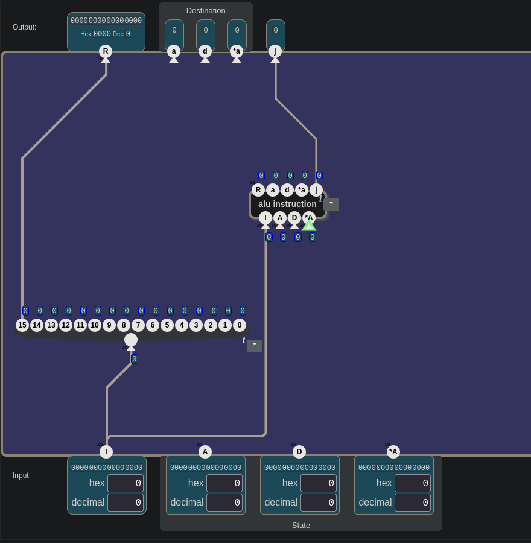
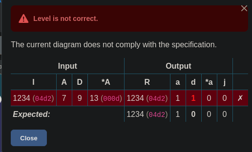
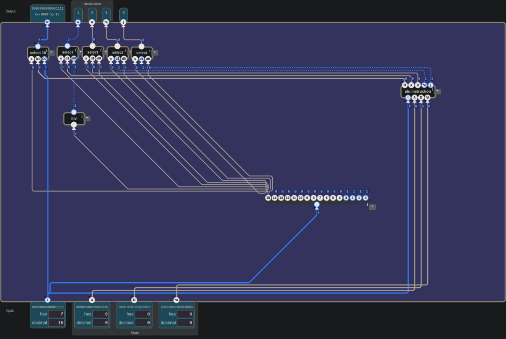
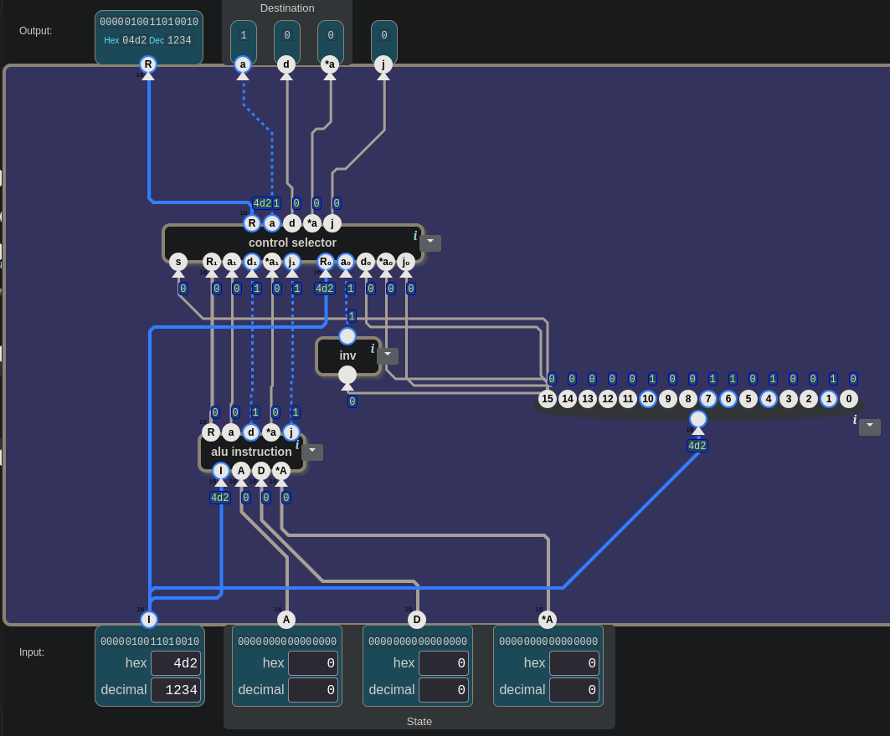
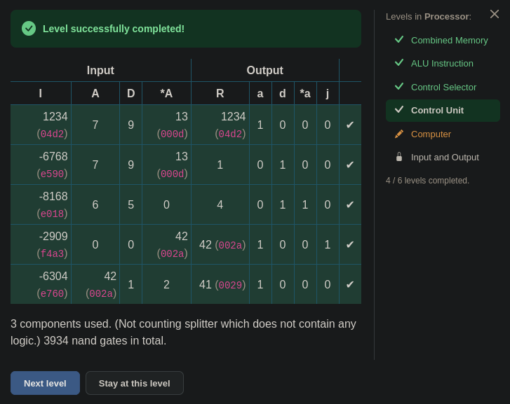

# 🧮 Şalterden Bilgisayara — Control Unit: Bir Bit, İki Tür Komut

> Bu seviyede bilgisayar ikinci bir komut türü öğrendi. İlk tel, komutun en
> soldaki bitini doğrudan R'ye götürdü ve R'de 5 yerine 0 göründü. Hangi bitlerin
> R'ye gitmesi gerektiği sorulunca cevap "hepsi" oldu. Sonra bir 1'e ihtiyaç doğdu
> ve "devrede hazır bir 1 yok mu?" diye soruldu. İlk Check geçti, ama oyunun
> kaçırdığı bir hata ondan sonra, elle yazılan bir testle bulundu. En sonda üstte
> yan yana dizilen beş seçici tanıdık geldi.

---

## 📋 İçindekiler

- [Bu Parça Ne Yapıyor?](#bu-parça-ne-yapıyor)
- [Okunan Değer, Yazma İzni](#okunan-değer-yazma-i̇zni)
- [R: Bir Bacak mı, Hepsi mi?](#r-bir-bacak-mı-hepsi-mi)
- [Kol Boşta Kalınca](#kol-boşta-kalınca)
- [Seçici Nasıl Sınanır?](#seçici-nasıl-sınanır)
- [a: Hazır Bir 1 Var mı?](#a-hazır-bir-1-var-mı)
- [d, *a, j: Sıfır Nereden?](#d-a-j-sıfır-nereden)
- [Oyunun Kaçırdığı Hata](#oyunun-kaçırdığı-hata)
- [Beşli Tanıdık Geldi](#beşli-tanıdık-geldi)
- [🎮 Şimdi Sen Kur](#-şimdi-sen-kur)
- [İki Açık Soru](#i̇ki-açık-soru)

---

## Bu Parça Ne Yapıyor?

Processor ünitesinin dördüncü seviyesi. Manzara şu:

```
girişler:   I (16 bit, komut) · A · D · *A (16'şar bit)
çıkışlar:   R (16 bit) · a · d · *a · j (1'er bit)
kutu:       nand · or · control selector · alu instruction · 16 bit splitter ·
            16 bit bundler · select · select 16 · is neg · inv · 0
```

Girişler ve çıkışlar [23](./23_alu_instruction.md#bu-parça-ne-yapıyor)'tekilerle
aynı. Toolbox'ta 23'te kurduğun devre `alu instruction` adıyla, 24'te kurduğun
devre `control selector` adıyla hazır duruyor.

Açılan pencere:

> *"Bilgisayar ALU komutlarına ek olarak **veri komutlarını** da desteklemeli. Bir
> veri komutunda komutun değeri doğrudan A register'ına yazılır. `I` komutunun en
> yüksek bitine göre ya bir veri komutunu ya da bir ALU komutunu çalıştıran bir
> kontrol birimi oluştur:"*

| bit 15 | |
|:-:|---|
| 0 | veri komutu |
| 1 | ALU komutu |

> *"ALU komutlarında çıkış, önceki seviyede tarif edildiği gibi olmalı. R, ALU
> işleminin sonucudur. Veri komutunda R çıkışı `I` girişinin kendisi olmalı, hedef
> de A register'ı olmalı. Yani `a` bayrağı 1, `d`, `*a` ve `j` bayrakları 0
> olmalı."*

Tek cümleyle: *komutun en soldaki bitine bak; 0 ise komutun kendisi bir sayıdır,
onu A'ya yaz; 1 ise komutu geçen seviyedeki gibi işlet.*

İki tür komutu iki tür kâğıt gibi düşünebilirsin. Veri komutu, üstünde yalnızca bir
sayı yazan bir not: "bunu A'ya yaz." ALU komutu bir iş emri: hangi işlem yapılacak,
hangi değerler kullanılacak, sonuç nereye konacak. Kâğıdın türünü köşedeki tek bir
işaret söylüyor: bit 15.

| bit 15 | tür | R | `a` | `d` | `*a` | `j` |
|:-:|---|:-:|:-:|:-:|:-:|:-:|
| 0 | veri komutu | `I` | 1 | 0 | 0 | 0 |
| 1 | ALU komutu | 23'teki gibi | 23'teki gibi | 23'teki gibi | 23'teki gibi | 23'teki gibi |

[21.5](./21.5_sayi_mi_komut_mu.md#sayı-komut-olunca)'te bir sayının bitleri kontrol
tellerine bağlanınca o sayının komut olduğunu görmüştün. Burada aynı 16 bitin iki
kaderi var: bit 15 = 1 ise geri kalan bitler ALU'ya ne yapacağını söyler; bit 15 =
0 ise hiçbiri kontrol teli olarak okunmaz, 16 bit bir sayı olarak A'ya gider.

Bit 15, üzerinde 15 yazan bacak: `I` kutusundaki 16 haneli ikilik sayının **en
solundaki** hanesi. Numaralar sağdan, 0'dan başlıyor
([23](./23_alu_instruction.md#12-bit-ile-bit-12)'teki kural).

> 💡 **Hex'te bit 15'i okumak:** her hex hanesi dört bit. En soldaki hane `0`–`7`
> ise bit 15 = 0, `8`–`f` ise bit 15 = 1. `0005` → 0, `8000` → 1, `f4a3` → 1.

---

## Okunan Değer, Yazma İzni

Seviyenin ortasında bir soru takıldı: *"Hepsinin birden 1 olduğu zaman mı bit 15
1 vermesi lazım?"* "Hepsi" burada alttaki `A`, `D` ve `*A` idi.

Bit 15'in onlarla bir ilgisi yok. Bit 15 yalnızca `I`'dan gelir. Ekranda iki ayrı
grup var:

```
ALTTA (girişler, dışarıdan gelir)
  I            →  komut. Bit 15 yalnızca burada.
  A · D · *A   →  register'larda ve RAM'de ŞU AN duran değerler. Okunan değer.

ÜSTTE (çıkışlar, devre üretir)
  R            →  sonuç
  a · d · *a   →  sonuç nereye yazılsın? Yazma izni.
  j            →  sonuç koşula uyuyor mu?
```

[22](./22_combined_memory.md#küçük-harf-büyük-harf)'deki kural: küçük harf yazma
izni, büyük harf okunan değer. Bit 15'in karar verdiği şey üstteki beş çıkış.

Bir şeyi daha fark et: veri komutunda `A`, `D` ve `*A`'ya hiç bakılmaz, çünkü
R = `I`. Okunan değerler yalnızca ALU komutunda, hesap yapılırken işe yarar.

---

## R: Bir Bacak mı, Hepsi mi?

İlk bağlantı şuydu: `I` bir `16 bit splitter`'a girdi, splitter'ın 15 numaralı
bacağı doğrudan R'ye gitti. Gerekçe: *"Bit 15'in 0 ya da 1 olması bizi
ilgilendiriyor, çünkü ona göre çıkışlara gideceğiz."*


*İlk bağlantı. Splitter'ın en soldaki bacağından (15) çıkan tel R'ye gidiyor; `alu instruction`'ın R'si boşta.*

Bunu sınamak için `I`'ya `5` yazıldı. Veri komutu, yani R'de 5 görülmeliydi.
Görülen 0'dı.

```
I = 5  =  0000 0000 0000 0101
          ↑               ↑ ↑
       bit 15 = 0      bit 2 ve bit 0 = 1
```

R'ye bağlı bacak bit 15'ti, 5'te o bit 0. R'de görülen 0 oradan geliyordu.

Sıradaki soru: *R'de 5 görmek için R'ye ne gitmeli?* İlk cevap *"2 ve 0. bit"*
oldu. 5 için doğru. Peki `I` = 6 olsaydı? `0110`: bu sefer bit 2 ve bit 1. Her
sayı başka bitleri açıyor. Devre bir tek 5 için değil, gelebilecek her veri komutu
için çalışmalı. Cevap şuna döndü: *"Hepsi o zaman."*

16 bitin hepsini birden taşıyan tel zaten devrede vardı: *"I'dan çıkan tel,
splitter'a girmeden önceki."*

> 🔑 **Bir bacak tek bir bit taşır. Sayının kendisi, sayıyı taşıyan teldedir.**

Ama R'nin iki adayı var:

| bit 15 | R'ye giden |
|:-:|---|
| 0 | `I`'dan çıkan tel |
| 1 | `alu instruction`'ın R'si |

Bir bite bakıp iki 16 bitlik değerden birini seçen parça: *"select 16."* `s` = 0
iken geçmesi gereken D0'a, yani `I` → D0, `alu instruction`'ın R'si → D1
([13](./13_arithmetic_unit.md#tuzak-d0-ve-d1-sadece-soket-adıdır)'teki tuzak).

---

## Kol Boşta Kalınca

`select 16` konup `I`'ya yine 5 yazıldı. R'de 5 göründü. Beklenen de buydu.


*`I` = 5, R = 5. Ama `select 16`'nın `s` bacağına hiçbir tel gelmiyor.*

Soru: *`select 16`'nın `s`'sine ne bağlı?* Cevap: *"Hiçbir şey."*

Oyunda bağlanmamış bir giriş 0 sayılır
([22](./22_combined_memory.md#bir-tel-kopuk-kalınca)'deki 🎮 kutusu; gerçekte boştaki
giriş tanımsızdır). `s` = 0 olunca seçici hep D0'ı, yani `I`'yı geçirdi. Test
**tesadüfen** geçti: veri komutu denendiği için D0'ın geçmesi zaten doğruydu.
[23](./23_alu_instruction.md#tesadüfen-geçen-testler)'te de kontrol telleri boşken
ilk iki test böyle geçmişti.

`s`'ye bağlanması gereken şey bit 15: splitter'da üzerinde 15 yazan bacak. O bacak
splitter'ın **en solunda**. Bacağın üstündeki numara her zaman doğrusunu söyler.

---

## Seçici Nasıl Sınanır?

`s` bit 15'e bağlandıktan sonra `I`'ya `8000` (32768) yazıldı: bit 15 = 1, ALU
komutu. Ekranda şu vardı:

```
D0 = 8000   (I'dan geliyor)
D1 = 0      (alu instruction'ın R'sinden geliyor)
s  = 1
R  = 0
```


*`I` = `8000` (32768). Kesikli mavi tel bit 15'ten `s`'ye gidiyor; `s` = 1, R'de 0.*

İlk izlenim: *"s 1 oldu ama D1 tetiklenmedi."* D1 bir tetik değil, bir değer
taşıyor. O an `alu instruction`'ın R'si 0'dı; seçici onu geçirdi.

Sağlaması tek soruyla yapıldı: *D0 seçilmiş olsaydı R'de ne görünürdü?* 8000. R'de
0 var, demek ki D1 seçilmiş.

> 🔑 **Seçicinin hangi bacağı geçirdiğini çıkıştaki değer söyler.** Çıkışı iki
> girişle karşılaştır, hangisine eşitse o geçmiştir. İki girişin değeri aynıysa
> test hiçbir şey söylemez; [24](./24_control_selector.md#farklı-değerlerle-sına)'teki
> gibi farklı değerler kullan.

---

## a: Hazır Bir 1 Var mı?

R bitti, sırada üstteki bayraklar var. Önce `a`:

| bit 15 | `a` |
|:-:|---|
| 0 | 1 |
| 1 | `alu instruction`'ın `a`'sı |

`a` tek bit, bu yüzden `select 16` değil `select`: `s` ← bit 15, `d1` ←
`alu instruction`'ın `a`'sı. `d0`'a ise **1** lazım.

[13](./13_arithmetic_unit.md#sabit-1i-kim-üretecek)'te sabit 1 bir `0` ile bir
`inv`'den üretilmişti. Burada bir soru soruldu: *"Bu iki kapıyı kullanmadan,
elimizde 1 üretebilecek herhangi bir şey yok mu? Devrede zaten olan bir yerden
alamaz mıyız?"*

Kapısız, hazır bir 1 yok. Kanıtı şu: veri komutunda `I`'nın geri kalan 15 biti
veri, yani her şey olabilir. `I` = 0 gelebilir. O zaman splitter'ın bütün bacakları
0 olur, `alu instruction`'ın tek bitlik çıkışları da 0 olur. "Veri komutunda hep 1"
diye güvenilecek bir tel yok. En az bir kapı şart.

Ama aranan teli tarif etmek işe yarıyor:

| bit 15 | aranan tel |
|:-:|:-:|
| 0 | 1 |
| 1 | fark etmez: seçici o an `d0`'a bakmıyor |

Bu tarifi tek kapı karşılıyor: **`inv`(bit 15)**. `0` + `inv` yerine yalnızca
`inv`, yani iki parça yerine bir parça.

Burada bir kaygı daha doğdu: *"Bit 15, 32768'den 65535'e kadar binlerce sayıda 1.
O sayılarda inverter 0 verecek. Karmaşa yaşanmayacak mı?"*

Yaşanmaz. Tel sayıyı bilmez; yalnızca 0 ya da 1 taşır. 65536 ayrı `I` değeri, bit
15'in telinde iki duruma iner. Bit 15 = 1 iken `inv` gerçekten 0 verir, ama o anda
seçici `d0`'a bakmaz:

| `I` | bit 15 | `inv` çıkışı → `d0` | seçici geçirir | `a` |
|---|:-:|:-:|:-:|---|
| `0005` (5) | 0 | 1 | `d0` | 1 ✓ |
| `8000` (32768) | 1 | 0 | `d1` | `alu instruction`'ın `a`'sı ✓ |
| `f4a3` (62627) | 1 | 0 | `d1` | `alu instruction`'ın `a`'sı ✓ |

> 🔑 **Aradığın teli önce tarif et:** hangi durumda ne olmalı, hangi durumda fark
> etmez. Tarif çoğu zaman parçayı kendisi söyler.

---

## d, *a, j: Sıfır Nereden?

`d`'nin tablosu `a`'nınkine benziyor, tek fark veri komutundaki değer:

| bit 15 | `d` |
|:-:|---|
| 0 | 0 |
| 1 | `alu instruction`'ın `d`'si |

İskelet aynı: `select`, `s` ← bit 15, `d1` ← `alu instruction`'ın `d`'si. `d0`
için gerekçe şu oldu: *"Burada inverter lazım değil, çünkü bit 15 0 olduğunda d'nin
de 0 olması isteniyor."*

`d0`'a **bit 15'in kendisi** bağlandı. `d0`'a yalnızca bit 15 = 0 iken bakılır, o
anda bit 15 zaten 0. Ek parça yok.

| bayrak | veri komutunda | `d0`'a giden |
|---|:-:|---|
| `a` | 1 | `inv`(bit 15) |
| `d` | 0 | bit 15 |

`d0` boş da bırakılabilirdi; oyun boştaki girişi 0 saydığı için Check yine geçerdi.
Ama bu, oyunun kolaylığına yaslanmak olurdu: gerçekte boştaki giriş tanımsızdır.
Bit 15'i bağlamak hem bedava hem gerçek bir devrede de doğru.

`*a` ve `j`'nin tabloları `d`'ninkiyle aynı: veri komutunda 0, ALU komutunda
`alu instruction`'dan.

---

## Oyunun Kaçırdığı Hata

`a`'nın seçicisi kurulduktan sonra `d`, `*a` ve `j` önce doğrudan
`alu instruction`'ın çıkışlarına bağlandı. İlk Check `d`'de düştü:


*`I` = `04d2` (1234), veri komutu. R ve `a` doğru, `d` 0 olmalıyken 1.*

`alu instruction` veri komutunu da ALU komutu sanıp okuyor; `04d2`'de `d`'nin yerine
denk gelen bit 4, 1. [24](./24_control_selector.md#tel-syi-duymaz)'teki kural: tel
`s`'yi duymaz. `d`'ye seçici kondu ve Check geçti:


*5 bileşen, 3908 nand. Beş satırın hepsi yeşil.*

Ama `*a` ve `j` hâlâ doğrudan `alu instruction`'a bağlıydı. `d`'yi bozan sorunun
aynısı onlarda da olmalıydı. Oyun neden görmedi?

Kendi testimizle bakalım. `I`'ya `F` (15) yazıldı: veri komutu, ilk hex hanesi 0.

| | R | `a` | `d` | `*a` | `j` |
|---|:-:|:-:|:-:|:-:|:-:|
| beklenen | 15 | 1 | 0 | 0 | 0 |
| görülen | 15 | 1 | 0 | **1** | **1** |

Oyun geçirdi, ama devre yanlış. Sebebi oyunun test tablosunda: beş satırın ilk hex
hanelerine bak. `04d2`, `e590`, `e018`, `f4a3`, `e760`. **Yalnızca biri veri
komutu.** O tek satırda da `*a` ile `j` tesadüfen 0 çıkıyor:

```
04d2  →  0000 0100 1101 0010
                         ↑ bit 3 = 0  →  alu'nun *a'sı 0  (tesadüfen doğru)
000F  →  0000 0000 0000 1111
                         ↑ bit 3 = 1  →  alu'nun *a'sı 1  (yanlış)
```

`j` için `alu instruction` son üç biti koşul olarak okuyor
([23](./23_alu_instruction.md#r-ve-j)):

- `04d2`'de son üç bit `010`: yalnızca "sonuç sıfıra eşit mi?" ALU'nun bu sayıdan
  çıkardığı sonuç 0 değil, `j` = 0. Tesadüf.
- `000F`'te son üç bit `111`: "sıfırdan küçük mü, eşit mi, büyük mü?" Her sayı
  bunlardan birine uyar, `j` hep 1.

> 🔑 **Şüphelendiğin bitleri 1 yapan bir sayıyla sına.** `04d2`'de `*a`'nın biti
> 0'dı, hata orada görünemezdi. `F`'te son dört bitin hepsi 1: `*a`'nın biti ve
> üç koşul biti birden açık. [13](./13_arithmetic_unit.md#testi-nasıl-seçersin)'teki
> kural: iyi test, devre bozuk olsaydı bunu fark ettirecek testtir.

`*a` ile `j`'ye de seçici kondu: `s` ← bit 15, `d1` ← `alu instruction`, `d0` ←
bit 15. Bu arada bir kez `d1` ile `d0` ters bağlandı; `e590` satırı `*a`'da düştü,
hakemin tablosuyla bulundu. Sonuç: 7 bileşen, 3934 nand, `F` testi de beklenen
gibi.

---

## Beşli Tanıdık Geldi


*Yedi bileşenli devre, `I` = `F`. Üstte beş seçici, hepsinin `s`'si bit 15'te.*

Üstte yan yana duran beş seçiciye bak. Bir `select 16`, dört `select`. Hepsinin
`s`'si aynı tele, bit 15'e bağlı. Her biri iki paketten birinin bir parçasını
geçiriyor:

```
bit 15 = 1  →  alu instruction'ın paketi:  R    a      d       *a      j
bit 15 = 0  →  veri komutunun paketi:      I    1      0       0       0
                                                (inv)  (bit 15)
```

Bu beşli görülünce şu söylendi: *"Bu beşli tanıdık geliyor… control selector gibi
geldi bana."*

Aynen o. [24](./24_control_selector.md#her-çıkışa-bir-seçici)'te kurulan parça: tek
bir `s`, iki paket, her çıkışın önünde bir seçici. Bu seviyede parça ezberden
gelmedi, ihtiyaçtan çıktı: önce R'ye bir seçici gerekti, sonra `a`'ya, `d`'ye,
`*a`'ya ve `j`'ye. Beşli kendiliğinden ortaya çıktı.

Beş seçici silinip yerine tek bir `control selector` konunca:

| control selector bacağı | bağlanan |
|---|---|
| `s` | bit 15 |
| R₁ · a₁ · d₁ · *a₁ · j₁ | `alu instruction`'ın R, `a`, `d`, `*a`, `j`'si |
| R₀ | `I` |
| a₀ | `inv`(bit 15) |
| d₀ · *a₀ · j₀ | bit 15 |

| çözüm | bileşen | nand |
|---|:-:|:-:|
| ilk geçen (`*a`, `j` seçicisiz, yanlış) | 5 | 3908 |
| beş seçici | 7 | 3934 |
| `control selector` | **3** | **3934** |

---

## 🎮 Şimdi Sen Kur

Parça listesi: **1 × `alu instruction`**, **1 × `control selector`**, **1 × `inv`**,
**1 × `16 bit splitter`**.

Bitirdiğinde giriş bacaklarını say: `alu instruction` 4, `control selector` 11,
`inv` 1, splitter 1, toplam **17**. Üstteki beş çıkışın her birine de bir tel.

### Nasıl test edersin

Önce veri komutlarını, sonra ALU komutlarını sına. 2. satır bu seviyenin en önemli
testi: oyunun kendi testleri bunu sormuyor.

| adım | `I` (hex) | `A` | `D` | `*A` | beklenen R | beklenen `a d *a j` | ne sınanıyor |
|---|---|:-:|:-:|:-:|:-:|:-:|---|
| 1 | `0005` | 0 | 0 | 0 | 5 | 1 0 0 0 | veri komutu: R = `I`, hedef yalnızca A |
| 2 | `000f` | 0 | 0 | 0 | 15 | 1 0 0 0 | `*a`'nın ve koşulun bitleri 1 olan veri komutu |
| 3 | `8000` | 0 | 0 | 0 | 0 | 0 0 0 0 | ALU komutu: R, `I` değil ALU'nun sonucu |
| 4 | `f4a3` | 0 | 0 | 42 | 42 | 1 0 0 1 | oyunun testi: tam bir ALU komutu |
| 5 | `04d2` | 7 | 9 | 13 | 1234 | 1 0 0 0 | oyunun testi: veri komutu |

<details>
<summary>🔑 Takıldıysan — bağlantı listesi</summary>

```
splitter:           giriş ← I
alu instruction:    I ← I     A ← A     D ← D     *A ← *A
inv:                giriş ← bit 15
control selector:   s ← bit 15
                    R₁ ← alu'nun R'si    a₁ ← a'sı    d₁ ← d'si    *a₁ ← *a'sı    j₁ ← j'si
                    R₀ ← I               a₀ ← inv     d₀ ← bit 15  *a₀ ← bit 15   j₀ ← bit 15
                    R, a, d, *a, j  →  çıkışlar
```

</details>

Oyunun cevabı:

> *"3 components used. (Not counting splitter which does not contain any logic.)
> 3934 nand gates in total."*


*Geçen devre, `I` = `04d2`. R'de 1234, `a` = 1, diğer bayraklar 0.*


*Oyunun testleri. Beş satırdan yalnızca ilki veri komutu.*

---

## İki Açık Soru

**1.** Beş seçiciden `control selector`'a geçince bileşen sayısı 7'den 3'e indi,
nand sayısı ise hiç değişmedi: 3934. Neden?

İpucu: [18](./18_data_flip_flop.md#kutular-açılınca)'de bunun tersi olmuştu. Kutular
açılınca bileşen sayısı artmış, nand sayısı azalmıştı.

**2.** Bit 15 artık komutun türünü söylüyor. Veri komutuyla A'ya yazılabilecek en
büyük sayı kaç? Negatif bir sayı yazılabilir mi?

İpucu: bit 15 tek başına 32768 (hex `8000`) değerinde. Veri komutunda o bit hep 0.

---

## Özet — Aklında Tut

```
☐ Control Unit: bit 15 = 0 → veri komutu (R = I, yalnızca a = 1); bit 15 = 1 → ALU komutu (23'teki gibi).
☐ Veri komutunda 16 bit kontrol teli olarak okunmaz; bir sayı olarak A'ya gider.
☐ Hex'te bit 15: en soldaki hane 0–7 → 0, 8–f → 1.
☐ Bit 15 yalnızca I'dan gelir. A, D, *A okunan değer; a, d, *a yazma izni.
☐ Veri komutunda A, D ve *A'ya hiç bakılmaz.
☐ 🔑 Bir bacak tek bir bit taşır. Sayının kendisi, sayıyı taşıyan teldedir: R₀ ← I.
☐ Boş s = 0 (oyunda) → seçici hep D0'ı geçirir. Veri komutuyla yapılan test tesadüfen geçer.
☐ 🔑 Seçicinin hangi bacağı geçirdiğini çıkıştaki değer söyler. Girişleri farklı değerlerle sına.
☐ Kapısız hazır bir 1 yok: I = 0 gelebilir, o zaman her tel 0.
☐ 🔑 Aradığın teli önce tarif et. "bit 15 = 0 iken 1, bit 15 = 1 iken fark etmez" → inv(bit 15).
☐ Tel sayıyı bilmez: 65536 değer, bit 15'in telinde iki duruma iner.
☐ d₀, *a₀, j₀ ← bit 15: ona yalnızca bit 15 = 0 iken bakılır, o anda kendisi 0. Ek parça yok.
☐ Tel s'yi duymaz: alu instruction veri komutunu da ALU komutu sanıp okur.
☐ ⚠️ Oyunun beş testinden yalnızca biri veri komutu (04d2); *a ve j orada tesadüfen 0.
☐ 🔑 Şüphelendiğin bitleri 1 yapan bir sayıyla sına: 000F → *a = 1, j = 1 hatayı gösterir.
☐ Beş seçici + ortak s = control selector (24). Parça ihtiyaçtan yeniden çıktı.
☐ Çözüm: alu instruction + control selector + inv = 3 bileşen, 3934 nand. Beş seçiciyle 7 bileşen, yine 3934.
```

---

## 🔗 İlgili Konular

- [24_control_selector.md](./24_control_selector.md) — Tek kol, iki paket; tel `s`'yi duymaz
- [23_alu_instruction.md](./23_alu_instruction.md) — ALU komutu; R ve `j`; testin geçmesi doğruluk değildir
- [22_combined_memory.md](./22_combined_memory.md) — Küçük harf, büyük harf; kopuk tel 0 sayılır
- [21.5_sayi_mi_komut_mu.md](./21.5_sayi_mi_komut_mu.md) — Bitleri kontrol tellerine bağlanan sayı komut olur
- [18_data_flip_flop.md](./18_data_flip_flop.md) — Bileşen sayısı ile nand sayısı
- [13_arithmetic_unit.md](./13_arithmetic_unit.md) — Sabit 1; D0 ve D1 yalnızca soket adı; testi nasıl seçersin

---

**Önceki konu:** [24_control_selector.md](./24_control_selector.md)
**Sonraki konu:** *(yolda — Processor ünitesinin beşinci seviyesi)*

*Bu ders, "Şalterden Bilgisayara" serisinin bir parçasıdır. Seri, [nandgame.com](https://nandgame.com) eşliğinde ilerler.*
