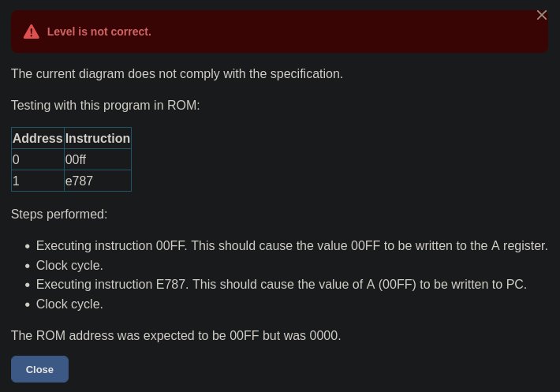
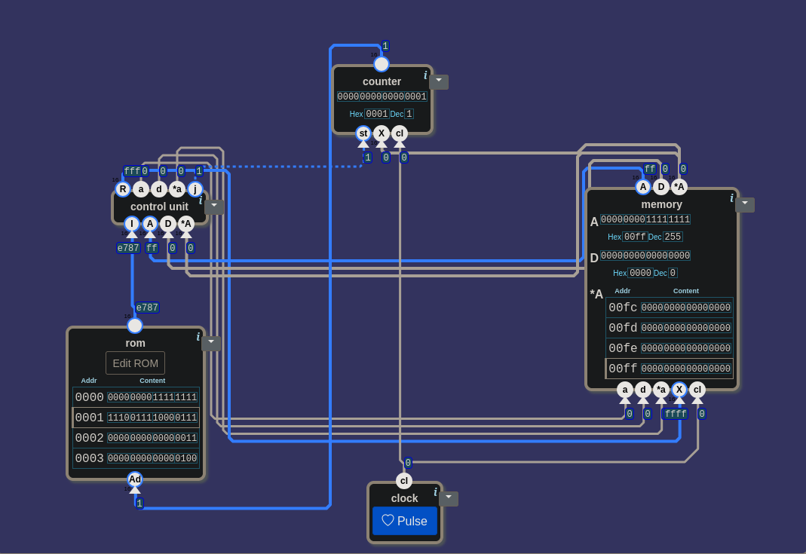
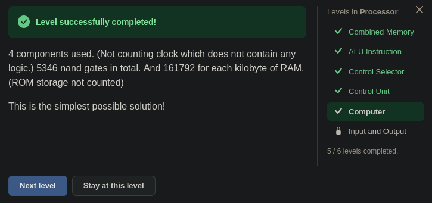

# 🧮 Şalterden Bilgisayara — Computer: Girişi Olmayan Makine

> Bu seviyede canvas'ta ne giriş vardı ne çıkış. İlk tepki şu oldu: *"Input ve
> output'u çalmışlar!"* Kimse dışarıdan bir şey yazmıyorsa makine ne yapacağını
> nereden öğrenecekti? Cevap pencerenin ortasındaki tek bir cümledeydi. "Kim neyi
> sayıyor?" sorusu 20'ye geri götürdü. Aranan bir parçanın toolbox'ta olmaması
> bir fazlalığı gösterdi. İlk Check'i iki satırlık bir program düşürdü; program
> elle, adım adım çalıştırılınca hata tek bir telde bulundu.

---

## 📋 İçindekiler

- [Bu Parça Ne Yapıyor?](#bu-parça-ne-yapıyor)
- [Giriş Yoksa Komut Nereden?](#giriş-yoksa-komut-nereden)
- [İki Bellek](#i̇ki-bellek)
- [Kim Neyi Sayıyor?](#kim-neyi-sayıyor)
- [Toolbox'ta Olmayan Parça](#toolboxta-olmayan-parça)
- [Döngü Kapanıyor](#döngü-kapanıyor)
- [Oyun Bir Program Çalıştırıyor](#oyun-bir-program-çalıştırıyor)
- [A mı, *A mı?](#a-mı-a-mı)
- [Kaç Nand?](#kaç-nand)
- [21.5'in Kalan Soruları](#215in-kalan-soruları)
- [🎮 Şimdi Sen Kur](#-şimdi-sen-kur)

---

## Bu Parça Ne Yapıyor?

Processor ünitesinin beşinci seviyesi. Manzara şu:

```
girişler:   yok
çıkışlar:   yok
kutu:       nand · control unit · memory · inv · and · or · rom · counter · clock
```

Toolbox'ta üç tanıdık devre hazır duruyor: [25](./25_control_unit.md)'te kurduğun
`control unit`, [22](./22_combined_memory.md)'de kurduğun `memory`,
[20](./20_counter.md)'de kurduğun `counter`. İki parça yeni: `rom` ve `clock`.

Seviyenin tanımı:

> *"Şunları birleştirerek bir bilgisayar kur:*
>
> - *bir kontrol birimi*
> - *depolama belleği (RAM ve register'lar)*
> - *bir program belleği birimi (ROM)*
> - *o anki komutun adresini takip eden bir sayaç ("program sayacı" ya da **PC**
>   denir)*
> - *bir saat birimi*
>
> *Program belleğinde PC adresindeki kelime, kontrol biriminin `I` girişidir.*
>
> *Her saat döngüsünde program sayacı `j`'ye göre değişir. `j` = 0 ise program
> sayacı 1 ilerlemeli. `j` = 1 ise PC, A'daki değere ayarlanmalı."*

Açılan pencere:

> *"Son göreve ulaştın. Bunu tamamlarsan çalışan, programlanabilir bir mikroişlemci
> kurmuş olursun."*

Yemek tarifi okuyan birini düşün. Parmağı hangi satırdaysa o satırdaki işi yapıyor,
sonra parmağını bir satır aşağı kaydırıyor. Satırda "3. adıma dön" yazıyorsa
parmağını 3. satıra götürüyor. Bu seviyedeki makine de böyle:

| her saat vuruşunda | parmak nereye gider |
|---|---|
| `j` = 0 | bir sonraki satıra |
| `j` = 1 | A'da yazan satıra |

`j` [23](./23_alu_instruction.md#r-ve-j)'ten beri hesaplanıyordu ama hiçbir yere
gitmiyordu. Control Unit'te şöyle söylenmişti: *"j sonucun koşula uyup uymadığını
söylüyor; atlama bu seviyede yok."* Atlama bu seviyede var.

---

## Giriş Yoksa Komut Nereden?

Canvas'ın üstünde `Output:`, altında `Input:` yazıyor, ama ikisinin yanı da boş.
Şimdiye kadar her seviyede girişlere elle değer verdin. Burada verecek bir giriş
yok.

Soru şuydu: *Kimse dışarıdan bir şey yazmıyorsa makine her saat vuruşunda ne
yapacağını nereden öğreniyor?*

Cevap tanımın ortasındaki cümlede: *"Program belleğinde PC adresindeki kelime,
kontrol biriminin `I` girişidir."* Şöyle söylendi: *"Program belleğinde (rom)
PC adresindeki kelime… control unit'in girişi."*

Komutlar dışarıdan gelmiyor, `rom`'da duruyor. İlk tel buradan çıktı:

```
rom'un çıkışı  →  control unit'in I'sı
```

> 🔑 **Bu bilgisayarın girişi yok, programı var.** Ne yapacağını her vuruşta kendi
> belleğinden okuyor.

---

## İki Bellek

Bu cümleden sonra bir şüphe doğdu: rom ile memory karıştırılmış olabilir miydi?
Toolbox'ta iki ayrı "bellek" var:

| | `rom` | `memory` |
|---|---|---|
| içinde ne var | komutlar | sayılar: A, D ve RAM |
| yazılabilir mi | hayır; altında tek giriş var, `Ad` | evet; altında yazma girişleri var: `a`, `d`, `*a`, `X`, `cl` |
| tarifte | tarif kitabı | tezgâh: hesapların konduğu yer |

Arkasından bir soru geldi: *"RAM'den rom'a giden bir şey yok mu?"* Doğrudan yok.
Rom'un tek girişi `Ad`; ona veri yazacak bir bacak yok. Rom yalnızca okunur. Tarif
kitabı pişirirken değişmiyor.

Memory'ye bakarken bir soru daha çıktı: *"D ne işe yarıyordu?"* Kısa hatırlatma:
RAM'de başka bir hücreye bakmak için A oynatılır, A'daki sayı da o an kaybolur. D,
A oynarken sayıyı tutan ikinci register
([22](./22_combined_memory.md#a-hem-veri-hem-adres)).

---

## Kim Neyi Sayıyor?

Rom'un `Ad`'ına ne gelmeli? Tanım söylüyor: *"PC adresindeki kelime."* `Ad`'a satır
numarası gitmeli. Satır numarasını tutan parça tanımın dördüncü maddesinde: *"o
anki komutun adresini takip eden bir sayaç."* Toolbox'ta adı `counter`.

İlk tepki: *"Sayaç?… Kim neyi sayıyor?"* Cevap için
[20](./20_counter.md#bu-parça-ne-yapıyor)'ye dönüldü. Oradaki tanım:

> *"Sayaç, her saat devrinde 16 bitlik bir sayıyı artıran bir parçadır. `st` 1 ise
> `X` girişi yeni sayaç değeri olarak kullanılır. `st` 0 ise önceki sayaç değeri
> 1 artırılır. Sayacın çıkışı `cl` 0'a inince değişir."*

Bu seviyede sayacın saydığı şey satır numarası. Çıkışı `Ad`'a gidiyor:

```
counter'ın çıkışı  →  rom'un Ad'ı
```

Şimdi iki tabloyu yan yana koy:

| counter (20) | yazılan | | parmak (bu seviye) | gittiği yer |
|---|---|---|---|---|
| `st` = 0 | çıkış + 1 | | `j` = 0 | bir sonraki satır |
| `st` = 1 | `X` | | `j` = 1 | A'da yazan satır |

Solda iki satırdan birini seçen `st`, sağda `j`. Bağlantı tablodan çıktı:
**`j` → `st`**.

Bir şey daha fark edildi: *"X dışarıdan verilen hazır aday idi; artık bu devreden
gelecek."* 20'de `st` ile `X`'i elle veriyordun. Burada ikisini de devrenin kendisi
üretiyor. [21.5](./21.5_sayi_mi_komut_mu.md#dışarıdan-gelen-teller)'teki kural: her
seviye, bir öncekinin dış girişlerinden bazılarını içeri alır.

---

## Toolbox'ta Olmayan Parça

`X`'e ne gelmeli? İlk cevap `*A` oldu. Arkasından bir plan geldi: `st` = 0 olunca
"bir sonraki satır" da bir yerden gelmeli, belki `*A`'dan. O zaman `X`'in önüne bir
`select 16` konur, A ile `*A` arasında seçim yapılır.

Ama toolbox'ta `select 16` yoktu. Plan sesli anlatılırken şu fark edildi: *"X
sadece st 1 olunca okunuyor."*

20'deki tabloya bak: `st` = 0 satırında `X` geçmiyor. Bir sonraki satırı counter
kendisi buluyor: çıkış + 1. `X`'e yalnızca atlama anında bakılıyor. Tek aday var,
seçici gereksiz. O aday tanımın son cümlesinde: *"`j` = 1 ise PC, A'daki değere
ayarlanmalı."* Yani `X` ← A.

> 💡 **Aradığın parça toolbox'ta yoksa tabloyu yeniden oku.** O işi yapan bir şeye
> gerçekten ihtiyaç var mı? Burada yoktu: `X`, `st` = 0 iken hiç okunmuyor.

---

## Döngü Kapanıyor

`clock`'un `cl`'si iki yere gitti: counter'ın ve memory'nin `cl`'sine. Bir şey
saklayan iki parça bunlar. `control unit` bir şey saklamıyor, `rom`'a da yazılmıyor;
ikisinin `cl` girişi yok.

Bu bağlantılardan sonra şu söylendi: *"Şu an kendi içerisinde bir döngü var."*

Geriye control unit'in R'si kaldı. Önceki seviyelerde R bir çıkışa gidiyordu, burada
çıkış yok. [25](./25_control_unit.md#okunan-değer-yazma-i̇zni)'te şu cümle
kurulmuştu: *"Büyük harfliler okunan değer, küçükler yazma izni."* `a`, `d` ve
`*a` "buraya yaz" iznini veriyor. Yazılacak değerin kendisi R'de. Memory'de o değeri
bekleyen giriş `X` ([22](./22_combined_memory.md#bu-parça-ne-yapıyor)):

```
control unit'in R'si          →  memory'nin X'i
control unit'in a, d, *a      →  memory'nin a, d, *a
memory'nin A, D, *A           →  control unit'in A, D, *A
```

Hesabın sonucu belleğe geri yazılıyor, bellekteki değerler hesaba geri dönüyor.
Hepsi bir arada:

```
   ┌──────────────────────── X ← A ─────────────────────────┐
   │  ┌───────── st ← j ──────────┐                         │
   ▼  ▼                           │                         │
 counter ──Ad──► rom ──I──► control unit ──R, a, d, *a──► memory
                                    ▲                       │
                                    └────── A, D, *A ───────┘
```

`clock`'un `cl`'si counter'a ve memory'ye.

---

## Oyun Bir Program Çalıştırıyor

İlk Check düştü:



> *"ROM'daki şu programla test ediliyor:"*
>
> | Adres | Komut |
> |---|---|
> | 0 | `00ff` |
> | 1 | `e787` |
>
> *"Yapılan adımlar: 00FF komutu çalıştırılıyor; bu, 00FF değerinin A register'ına
> yazılmasını sağlamalı. Saat döngüsü. E787 komutu çalıştırılıyor; bu, A'nın
> değerinin (00FF) PC'ye yazılmasını sağlamalı. Saat döngüsü. ROM adresinin 00FF
> olması bekleniyordu ama 0000'dı."*

Önceki seviyelerde oyun satırları tek tek sınıyordu. Burada iki satırlık bir program
çalıştırıyor. `00ff` (255) bir veri komutu: bit 15 = 0, A'ya 255 yaz. `e787` bir
ALU komutu; son üç biti `111`, yani koşul her sayıda doğru: `j` = 1, atla.

Aynı program elle çalıştırıldı. Rom'daki `Edit ROM` düğmesi bir editör açıyor; her
bit bir kutu, sütunların üstünde de bitlerin adı yazıyor:

| | ci | - | - | * | - | u | op1 | op0 | zx | sw | a | d | *a | lt | eq | gt |
|---|:-:|:-:|:-:|:-:|:-:|:-:|:-:|:-:|:-:|:-:|:-:|:-:|:-:|:-:|:-:|:-:|
| `00ff` | 0 | 0 | 0 | 0 | 0 | 0 | 0 | 0 | **1** | **1** | **1** | **1** | **1** | **1** | **1** | **1** |
| `e787` | **1** | **1** | **1** | 0 | 0 | **1** | **1** | **1** | **1** | 0 | 0 | 0 | 0 | **1** | **1** | **1** |


*Editörün `Hex` sütununda `00ff` ve `e787`. En sağdaki sütun komutların kısa adını yazıyor: `A = 255` ve `JMP`.*

> 🔑 **`Hex` sütunu sağlamadır.** Bitleri yazdıktan sonra 0. satırda `00ff`, 1.
> satırda `e787` görmelisin. Farklı bir şey görürsen bir bit yanlış yazılmış
> demektir.

`clock`'taki `Pulse` düğmesine bir kez basmak bir saat döngüsü. Beklenen:

| ne zaman | counter | memory'nin A'sı |
|---|:-:|:-:|
| başta | 0 | 0 |
| 1. Pulse'tan sonra | 1 | `00ff` (255) |
| 2. Pulse'tan sonra | **`00ff` (255)** | `00ff` (255) |

1. Pulse'tan sonra counter 1, A `00ff`: tabloyla aynı. 2. Pulse'a basmadan durup
bakıldı. `I` = `e787`, `j` = 1, counter'ın `st`'si 1. Bir sonraki vuruşta counter
`X`'te ne varsa onu yazacak. `X`'te 0 vardı:


*1. Pulse'tan sonra. Counter 1, memory'nin A'sı `00ff`, `I` = `e787`, `st` = 1. Counter'ın `X`'inde 0.*

`X`'in teli izlendi: memory'nin `*A`'sına bağlıydı. Fikir "`X` ← A" olarak
düzelmişti, tel ise ilk fikirde kalmıştı. Bunu ancak test gösterdi.

> 🔑 **Sonuç yanlışsa programı adım adım çalıştır.** Oyun yalnızca son durumu
> söylüyor: 0000. Her vuruştan sonra durup bakınca hata tek bir tele iniyor.

---

## A mı, *A mı?

Tel taşınırken bir soru soruldu: *"Ama neden ilk önce X'e memory'nin *A'sı dedik?"*

"A'nın gösterdiği satıra atla" cümlesi kulağa `*A` gibi geliyor, çünkü "gösterdiği"
kelimesi tam `*A`'nın tarifi. Ama ikisi farklı şeyler:

| | ne | testte |
|---|---|---|
| A | bir sayı; burada satır numarası | `00ff` (255) |
| `*A` | RAM'de A numaralı hücrede duran değer | RAM'in `00ff` hücresi boş: 0 |

Atlamak için satır numarası lazım, yani A. `*A` tezgâhtaki bir hücrenin içindeki
değer; rom'un satırlarıyla ilgisi yok. Testte o hücre boştu: `X` 0 oldu, counter 0'a
döndü. Oyunun gördüğü buydu: *"0000'dı."*

[22](./22_combined_memory.md#a-hem-veri-hem-adres)'de A'nın iki işi vardı: bir sayı
saklamak ve RAM'e adres göstermek. Bu seviyede A ikinci bir belleğe de adres
veriyor:

```
A  →  RAM'e, doğrudan:                  *A
A  →  rom'a, atlama anında dolaylı:     X → counter → Ad
```

Memory rom'a doğrudan bağlanmıyor. Ama atlama anında A, counter üzerinden rom'un
hangi satırı okuyacağını belirliyor.

Tel A'ya taşınınca iki adım yeniden çalıştırıldı. 2. Pulse'tan sonra counter
`00ff` gösterdi ve Check geçti.

---

## Kaç Nand?

Oyunun cevabı:

> *"4 components used. (Not counting clock which does not contain any logic.) 5346
> nand gates in total. And 161792 for each kilobyte of RAM. (ROM storage not
> counted) This is the simplest possible solution!"*

| parça | nand | kurulduğu ders |
|---|:-:|---|
| `control unit` | 3934 | [25](./25_control_unit.md) |
| `counter` | 996 | [20](./20_counter.md) |
| `memory` | 416 (+ RAM'in her kilobaytı için 161792) | [22](./22_combined_memory.md) |
| `rom` | 0 (depolama sayılmıyor) | — |
| `clock` | sayılmıyor: içinde mantık yok | — |
| **toplam** | **5346** | |

3934 + 996 + 416 = 5346.

> 🔑 **Bu seviye tek bir yeni kapı eklemedi.** Bilgisayar, önceki derslerde kurulan
> parçaların birbirine tellenmesiyle çıktı.

---

## 21.5'in Kalan Soruları

[21.5](./21.5_sayi_mi_komut_mu.md#processora-girerken)'in sonunda üç soru
bırakılmıştı. İkincisi [23](./23_alu_instruction.md#üç-sorudan-biri-cevaplandı)'te
cevaplanmıştı. Kalan ikisi bu seviyede kapandı:

**1.** *Bellekte arka arkaya duran komutları **sırayla** okumak için hangi sayıyı kim
tutmalı?* Satır numarasını, yani PC'yi `counter` tutuyor. Her vuruşta 1 artıyor,
atlama anında A'yı alıyor.

**3.** *`cl` ünitenin sonuna kadar dışarıdan mı geliyor?* Bu seviyede dış giriş hiç
yok. `cl` toolbox'taki `clock` kutusundan geliyor. Oyun onu sayıma katmıyor:
*"içinde mantık yok."* Yine hiçbir kapının çıkışı değil.

---

## 🎮 Şimdi Sen Kur

Parça listesi: **1 × `control unit`**, **1 × `memory`**, **1 × `rom`**,
**1 × `counter`**, **1 × `clock`**.

Bitirdiğinde giriş bacaklarını say: `rom` 1, `control unit` 4, `memory` 5, `counter`
3, toplam **13**. `clock`'un girişi yok.

### Nasıl test edersin

`Edit ROM` ile 0. satıra `00ff`, 1. satıra `e787` yaz (bitleri yukarıdaki tabloda).
`Hex` sütunuyla sağla. Sonra `Pulse`'a birer kez bas, her basıştan sonra dur ve bak:

| adım | ne zaman | `I` | counter | counter'ın `X`'i | memory'nin A'sı | ne sınanıyor |
|---|---|:-:|:-:|:-:|:-:|---|
| 1 | başta | `00ff` | 0 | 0 | 0 | rom'un 0. satırı `I`'da |
| 2 | 1. Pulse'tan sonra | `e787` | 1 | `00ff` | `00ff` (255) | veri komutu A'ya yazıldı; `j` = 0 → bir sonraki satır |
| 3 | 2. Pulse'tan sonra | `0000` | `00ff` (255) | `00ff` | `00ff` | `j` = 1 → PC ← A |

2. adımdaki `X` bu seviyenin en önemli bakışı: atlamadan önce counter'ın yazacağı
değeri gösteriyor.

<details>
<summary>🔑 Takıldıysan — bağlantı listesi</summary>

```
rom:            Ad ← counter'ın çıkışı
control unit:   I ← rom'un çıkışı
                A ← memory'nin A'sı    D ← D'si    *A ← *A'sı
memory:         X ← control unit'in R'si
                a ← a'sı    d ← d'si    *a ← *a'sı
                cl ← clock
counter:        st ← control unit'in j'si
                X ← memory'nin A'sı
                cl ← clock
```

</details>


*Geçen devre, iki Pulse'tan sonra. Counter `00ff`'te; `X` ← memory'nin A'sı.*


*4 bileşen, 5346 nand. Sırada Processor ünitesinin son seviyesi: Input and Output.*

---

## Özet — Aklında Tut

```
☐ Computer: control unit + memory + rom + counter + clock. Dış giriş ve çıkış yok.
☐ 🔑 Bu bilgisayarın girişi yok, programı var: rom'da PC adresindeki kelime → control unit'in I'sı.
☐ İki bellek: rom = komutlar, yalnızca okunur (tek giriş Ad) · memory = A, D, RAM, yazılır.
☐ Rom'a hiçbir şey yazmaz. Ad'a yalnızca satır numarası gider.
☐ PC = counter: satır numarasını tutar. counter → rom'un Ad'ı.
☐ counter (20) ↔ parmak: st = 0 → +1 ↔ j = 0 → sonraki satır · st = 1 → X ↔ j = 1 → A'daki satır. Yani j → st.
☐ 20'de elle verilen st ve X burada devrenin içinden gelir.
☐ X yalnızca st = 1 iken okunur → seçici gereksiz. 💡 Aranan parça toolbox'ta yoksa tabloyu yeniden oku.
☐ clock → counter'ın ve memory'nin cl'si: bir şey saklayan iki parça.
☐ R → memory'nin X'i; a, d, *a yazma izni; A, D, *A control unit'e geri. Döngü kapandı.
☐ Oyun artık bir programla sınıyor: 00ff (A = 255), e787 (JMP).
☐ 🔑 Hex sütunu sağlamadır. Bir Pulse = bir saat döngüsü.
☐ 🔑 Sonuç yanlışsa programı adım adım çalıştır: hata tek bir tele iner.
☐ Atlamada X ← A, *A değil. A = satır numarası, *A = RAM'de o hücredeki değer.
☐ A iki belleğe adres verir: RAM'e doğrudan (*A), rom'a atlama anında counter üzerinden.
☐ Kafada düzelen fikir canvas'ta düzelmiş olmayabilir. Bunu test gösterir.
☐ Çözüm: 4 bileşen, 5346 nand = 3934 + 996 + 416. Bu seviye yeni kapı eklemedi.
```

---

## 🔗 İlgili Konular

- [25_control_unit.md](./25_control_unit.md) — Veri komutu ve ALU komutu; okunan değer, yazma izni
- [23_alu_instruction.md](./23_alu_instruction.md) — `j`: koşul bitleri
- [22_combined_memory.md](./22_combined_memory.md) — A hem veri hem adres; memory'nin girişleri
- [21.5_sayi_mi_komut_mu.md](./21.5_sayi_mi_komut_mu.md) — Dış girişler içeri alınır; `cl` nereden gelir
- [20_counter.md](./20_counter.md) — `st` ve `X`; çıkış + 1

---

**Önceki konu:** [25_control_unit.md](./25_control_unit.md)
**Sonraki konu:** [27_input_and_output.md](./27_input_and_output.md)

*Bu ders, "Şalterden Bilgisayara" serisinin bir parçasıdır. Seri, [nandgame.com](https://nandgame.com) eşliğinde ilerler.*
