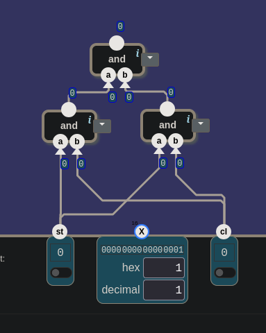

# 🧮 Şalterden Bilgisayara — Input and Output: Adres Gibi Görünen Lamba

> İlk fikir şuydu: düğmeye basılınca saat çalışmaya başlar, lamba da yanar. Oysa
> düğme ile lamba birbirine hiç bağlanmıyordu. Düğme splitter'a takılınca 15. bit
> yerine en sağdaki bit yandı. Üç `and` aynı şeyi üç kez hesapladı. "X = 1"
> lambayı yakmadı, söndürdü. İlk Check'te oyun lambaya itiraz etmedi, düğmenin hiç
> olmadığını söyledi. Seviye geçtikten sonra da asıl soru kaldı: düğme dışarıdan
> giren bir şeyse neden "Output"a gidiyor?

---

## 📋 İçindekiler

- [Bu Parça Ne Yapıyor?](#bu-parça-ne-yapıyor)
- [Düğme Lambayı Yakmıyor](#düğme-lambayı-yakmıyor)
- [Splitter Açar, Bundler Toplar](#splitter-açar-bundler-toplar)
- [Postacı Geldi](#postacı-geldi)
- [X'e 1 Yazınca Hangi Bit Yanar?](#xe-1-yazınca-hangi-bit-yanar)
- [Düğmeyi Unutmak](#düğmeyi-unutmak)
- [Output Kimin Çıkışı?](#output-kimin-çıkışı)
- [Kaç Nand?](#kaç-nand)
- [İki Açık Soru](#i̇ki-açık-soru)
- [Processor Ünitesi Bitti](#processor-ünitesi-bitti)
- [🎮 Şimdi Sen Kur](#-şimdi-sen-kur)

---

## Bu Parça Ne Yapıyor?

Processor ünitesinin altıncı ve son seviyesi. Manzara şu:

```
girişler:   st (1 bit) · X (16 bit) · cl (1 bit)
çıkış:      16 bit
kutu:       button · lamp · 16 bit splitter · 16 bit bundler · select 16 · and · nand · 0
```


Açılan pencere:

> *"Bir bilgisayarın işe yaraması için dış dünyayla iletişim kurabilmesi gerekir.
> Bu; ekran, klavye, dokunmatik sensörler, ağ arayüzü gibi donanım cihazlarıyla
> olur. Bu seviyede basit donanım cihazlarını bağlıyoruz: bir lamba ve bir düğme."*

Seviyenin tanımı:

> *"Bir lamba ve bir düğmeyi, **bir bellek adresi gibi** erişilebilecek şekilde
> bağla.*
>
> ***Cihaza çıktı:** Lamba X'in bit 0 ve bit 1'i ile kontrol edilir. Bit 1, 1
> olduğunda lamba **on** girişinden sinyal almalı. Bit 0, 1 olduğunda lamba
> **off** girişinden sinyal almalı. Sinyaller donanıma `st` (kaydet) 1 ve `cl`
> (saat sinyali) 1 olduğunda gönderilmeli.*
>
> ***Cihazdan girdi:** Düğmenin durumu bileşen çıkışının 15. bitinde görünür.
> Düğmeye basılıyken bit 15 = 1, basılı değilken 0 olmalı. Girdi sinyalleri
> **hemen** okunabilir olmalı."*

Bir posta kutusu düşün. Lambaya bir not bırakıyorsun: "yak" ya da "söndür". Not,
ancak postacı geldiğinde iletiliyor. Kutunun üstünde bir de bayrak var. Bayrağı
dışarıdaki biri kaldırıyor; ona bakan herkes, postacıyı beklemeden, her an
görüyor.

İstenen davranış iki tablo:

| `st` | `cl` | lamba ne alır? |
|:-:|:-:|---|
| 0 | herhangi | hiçbir şey |
| 1 | 0 | hiçbir şey |
| 1 | 1 | X'in bit 1'i 1 ise **on**, bit 0'ı 1 ise **off** |

| düğme | çıkışın bit 15'i | ne zaman |
|---|:-:|---|
| basılı | 1 | hemen |
| basılı değil | 0 | hemen |

---

## Düğme Lambayı Yakmıyor

İlk fikir şöyle anlatıldı: *"Düğmeye bastığımızda cl'nin vuruşları aktive olacak,
bir anlam kazanacak. Ama lambanın yanık ya da sönük kalması st ile kaydedilmeli."*

Bir yarısı doğru: lambaya yazmak lambanın durumunu değiştirmek demek, `st` ve `cl`
şartı da bundan geliyor. Öbür yarısında iki şey karışmış.

Birincisi, düğme lambayı yakmıyor. Tanım açık: *"Lamba X'in bit 0 ve bit 1'i ile
kontrol edilir."* Lambayı X yakıyor, yani bilgisayarın içindeki program. Düğmeye
dışarıdaki insan basıyor, bilgisayar da onu okuyor. İki cihazın yönü ters:

```
lamba :  bilgisayar ──► dışarı      (yazma)
düğme :  dışarı ──► bilgisayar      (okuma)
```

İkincisi, `cl` düğmeye basılınca gelmiyor. [26](./26_computer.md#döngü-kapanıyor)'da
`cl`, toolbox'taki `clock` kutusundan geliyordu. Düğmeye basılsa da basılmasa da
saat çalışıyor.

> 🔑 **Bu seviyede iki ayrı cihaz var, aralarında tel yok.** Lamba bilgisayardan
> dışarı, düğme dışarıdan bilgisayara.

---

## Splitter Açar, Bundler Toplar

Düğmenin yolu kurulurken önce splitter denendi: *"Düğmeye basıyorum. 15. değil, 1.
bit yanıyor. Kafam karıştı."*

Splitter 16 bitlik bir teli tek tek bitlere **açar**. Düğme ise tek bitlik bir
sinyal veriyor. Oyun bu tek biti 16 bitlik bir sayı gibi okudu: değeri 1. 1 sayısı
da en sağdaki bitte durur. Yanan bit oydu.

Aynı mesajda yön kendiliğinden döndü: *"Ya da bundler'ı alıp 15. bite bağlayıp
bundler'ın çıkışını kullanacağım."* Bundler bunun tersini yapar: tek tek bitleri
**toplar**, 16 bitlik bir tel çıkarır. Düğme hangi bacağına takılırsa sinyal o
bitte durur.

```
bit:  15  14  13  …  2   1   0
       ▲                     ▲
   düğme burada          splitter'da
   olmalı                yanan bu
```

"1. bit" denen bit aslında bit 0'dı. [23](./23_alu_instruction.md#12-bit-ile-bit-12)'te
aynı karışıklık yaşanmıştı: bitler sağdan sola, **0'dan** başlayarak numaralanır.
"Birinci bit"in adı bit 0, en soldakinin adı bit 15.

| parça | girer | çıkar |
|---|---|---|
| `16 bit splitter` | 16 bitlik tek tel | 16 ayrı bit |
| `16 bit bundler` | 16 ayrı bit | 16 bitlik tek tel |

---

## Postacı Geldi

Lamba tarafına geçmeden bir soru soruldu: *"st ve cl şartı lambanın on ve off
olması için gerekli şart bu, değil mi? Sadece on durumu için değil."* Evet. Şart
lambanın kendisi için konmuş, iki girişin ikisi için de geçerli. Postacı gelmeden
kutuya ne "yak" notu düşer ne "söndür" notu.

İlk kurulan devre şuydu:


*İlk deneme. Alttaki iki `and`'in ikisine de `st` ve `cl` gidiyor, üstteki ikisinin çıkışını alıyor. X hiçbir yere bağlı değil.*

Teller okununca:

```
soldaki and  =  st VE cl
sağdaki and  =  st VE cl                 ← aynı iki tel
üstteki and  =  (st VE cl) VE (st VE cl)  =  yine st VE cl
```

Üç kapı tek bir `and`'in işini yapıyordu. Planın aslı sorulunca: *"İlk başta select
16 ile seçtirecektim. İkisi de 1 ise lambanın on ve off'una dağıtacaktım."*

"İkisi de 1 ise" cümlesi `and`'in tanımı. `select 16` başka bir soru soruyor: iki
veriden hangisini geçireyim? `s` = 0 ise `D0`'ı, `s` = 1 ise `D1`'i. "İkisi de 1
mi?" diye sormuyor. Burada iki veri arasında seçim yok; tek bir izin var:

```
st ──┐
     and ──►  "postacı geldi"
cl ──┘
```

Sıradaki soru: postacı geldi, on'a sinyal gitmesi için başka ne lazım? Cevap:
*"Yine and değil mi? X'ten gelen ve ilk and'in çıkışı."*

[15](./15_condition.md#vana-olarak-and)'te `and` bir vana olarak kullanılmıştı:
izin 0 ise hiçbir şey geçirmez, izin 1 ise teldeki değeri aynen geçirir. Burada
izin "postacı geldi" teli, geçirilen değer X'in bir biti. On ve off iki ayrı vana;
aynı izin teli ikisine de gidiyor.

> 🔑 **"İkisi de 1 ise" bir `and`'dir, seçici değil.** Seçici iki veriden birini
> geçirir; `and` bir izinle tek bir değeri geçirir ya da tutar.

---

## X'e 1 Yazınca Hangi Bit Yanar?

Planda bir cümle vardı: *"x = 1 ve st = 1, cl = 1 durumu karşılanır."* Ama "X = 1"
"on biti 1" demek değil. X 16 bitlik bir sayı. Ekranda decimal 1 yazınca:

```
X = 1   →   0000 0000 0000 0001   →   bit 0 = 1   →   OFF
X = 2   →   0000 0000 0000 0010   →   bit 1 = 1   →   ON
```

X'e 1 yazmak lambaya "söndür" demek. Yakmak için X = 2.

`and`'in girişi tek bit, X ise 16 bit. X'in içinden yalnızca bit 1'i nasıl
çıkarırsın? Cevap tek kelimeydi: *"Splitter kullanırım."*

```
X ──► splitter ──► bit 1 ──┐
                           and ──► lamba ON
"postacı geldi" ───────────┘

X ──► splitter ──► bit 0 ──┐
                           and ──► lamba OFF
"postacı geldi" ───────────┘
```

Bir çıkış birden fazla yere gidebilir. "Postacı geldi" teli iki vanaya birden
dağıtıldı.

> ⚠️ **"X = 1" bir sayıdır, "bit 1 = 1" bir teldir.** Decimal 1'de yanan bit, bit
> 0. Bit 1'i yakan sayı 2.

---

## Düğmeyi Unutmak

Lamba kurulup Check'e basıldı:


*X = 1, `st` = 1, `cl` = 1. Lambanın on'una 0, off'una 1 gidiyor. Oyunun itirazı lambaya değil.*

> *"Seviye doğru değil. Diyagram tanıma uymuyor. Çözümde bir button bileşeni
> olması gerekiyor."*

Tepki: *"Harbi düğmeyi unutmuşum."* Ekrandaki değerler lamba tarafının doğru
olduğunu gösteriyordu: X = 1'de "postacı geldi" 1, on'a giden `and` 0, off'a
giden `and` 1. Düğme eklendi:

```
button ──► bundler'ın bit 15'i ──► Output
```

İkinci Check geçti.

> 💡 **Oyunun hata mesajını sonuna kadar oku.** "Level is not correct" her şeyin
> yanlış olduğunu söylemiyor. Bu sefer yalnızca bir parçanın eksik olduğunu
> söylüyordu.

---

## Output Kimin Çıkışı?

Seviye geçtikten sonra bir soru kaldı: *"Düğme ne işe yarıyor da Output'a gidiyor?
X'e başka değer verince boştaki çıkışlar 1 oluyor ama hiçbir şey olmuyor."*

Kafa karıştıran kelime seçimi. Düğme dışarıdan bilgisayara giren bir **girdi**,
ama canvas'ta "Output" yazan yere bağlanıyor. Çünkü bu "Output" dış dünyanın
değil, kutunun çıkışı: işlemciye gidiyor. Bu seviyede kurulan kutu işlemci ile dış
dünya arasında duruyor:

```
               İŞLEMCİ  (26'da kurulan Computer)
      yazmak için │ st, X, cl            ▲ okumak için
                  ▼                      │ "Output"
     ┌──────────────── bu seviyenin kutusu ───────────────┐
     │  lamba ◄── st·cl + bit 1/0      düğme ──► bit 15    │
     └────────────────────────────────────────────────────┘
                  │                      ▲
                  ▼                      │
             dışarıdaki göz        dışarıdaki parmak
```

Canvas'ın altındaki **Input** (`st`, `X`, `cl`) işlemciden geliyor. Üstteki
**Output** işlemciye gidiyor. Düğmenin işi şu: program bu kutuyu okuyor, bit 15'e
bakıyor, düğmeye basılıp basılmadığına göre karar veriyor.

"Bir bellek adresi gibi" cümlesi de buradan geliyor. Kutunun bacaklarını
[22](./22_combined_memory.md#bir-tel-kopuk-kalınca)'deki `register` kutusuyla
karşılaştır:

| | `register` (22) | bu seviyenin kutusu |
|---|---|---|
| girişler | `st` · `X` (16 bit) · `cl` | `st` · `X` (16 bit) · `cl` |
| çıkış | 16 bit: saklanan değer | 16 bit: bit 15'te düğme |
| yazma | `st` = 1 iken, zilde | `st` = 1 iken, zilde (`cl` = 1) |

İşlemci bu kutuya bir register'a yazar gibi yazıyor, bir register'ı okur gibi
okuyor. Lambanın ve düğmenin ne olduğunu bilmesine gerek yok. Onun için ikisi de
bir adres.

> 🔑 **İşlemci dış dünyaya bir adres üzerinden dokunuyor.** Lambaya yazmak bir
> adrese yazmak, düğmeyi okumak bir adresi okumak.

Boştaki bitlere gelince: X'e başka bir değer verince splitter'ın diğer çıkışları 1
oluyor ama hiçbir şey olmuyor. Doğru gözlem, olmaması da gerekiyor. Lamba
yalnızca bit 0'ı ve bit 1'i dinliyor; X'in geri kalan 14 biti bu kutu için
anlamsız.

> 🎮 **Oyun burada kolaylaştırıyor:** bundler'ın bit 15 dışındaki 15 bacağı boşta
> kaldı, oyun hepsini 0 saydı. [22](./22_combined_memory.md#bir-tel-kopuk-kalınca)'deki
> kutu: bağlanmamış bir giriş oyunda 0'dır. **Gerçekte:** boşta kalan giriş 0
> değildir, değeri tanımsızdır. Toolbox'ta `0` diye bir parça da vardı; bu
> çözümde kullanılmadı.

---

## Kaç Nand?

Oyunun cevabı:

> *"3 components used. (Not counting lamp and splitter and button and bundler
> which does not contain any logic.) 9 nand gates in total."*

| parça | adet | sayılıyor mu |
|---|:-:|---|
| `and` | 3 | evet: toplam 9 nand |
| `lamp`, `button` | 1'er | hayır: cihaz |
| `16 bit splitter`, `16 bit bundler` | 1'er | hayır: içlerinde mantık yok, yalnızca tel |

Oyun burada `and` kutusunu 3 nand sayıyor: 9 ÷ 3. [18](./18_data_flip_flop.md)'deki
not geçerli: oyunun bir kutuyu kaç nand saydığını tahmin etme, ölç.

> 🔑 **Splitter ve bundler tel düzenidir, kapı değil.** Bir teli açmak ya da
> toplamak hiçbir şey hesaplamıyor.

---

## İki Açık Soru

**1.** Lambaya yazmak lambanın durumunu değiştiriyor; bu yüzden `st` ve `cl`
bekleniyor. Düğmeyi okumak neyin durumunu değiştiriyor? Girdi neden "hemen"
okunabiliyor?

İpucu: [22](./22_combined_memory.md#küçük-harf-büyük-harf)'de küçük harf yazma
izniydi, büyük harf okunan değer. Aynı derste memory'nin tarifi: *"zil çalınca
oraya yazayım; her an da A'yı, D'yi ve A'nın gösterdiği RAM hücresini
göstereyim."*

**2.** Düğme neden bit 0'da değil de bit 15'te?

İpucu: [25](./25_control_unit.md#i̇ki-açık-soru)'te bit 15 tek başına 32768 (hex
`8000`) değerindeydi. [15](./15_condition.md#vana-olarak-and)'teki `lt` hangi
sayılarda 1 oluyordu?

---

## Processor Ünitesi Bitti


*3 bileşen, 9 nand. Sağda: "All levels in Processor completed!"*

Ünitenin altı seviyesi:

| ders | seviye | ne kuruldu |
|---|---|---|
| [22](./22_combined_memory.md) | Combined Memory | A, D ve RAM tek kutuda; A hem veri hem adres |
| [23](./23_alu_instruction.md) | ALU Instruction | komutun bitleri ALU'ya ve koşula dağıldı |
| [24](./24_control_selector.md) | Control Selector | tek kol iki paketten birini bütün olarak geçirir |
| [25](./25_control_unit.md) | Control Unit | bit 15 komutun türünü söyler: veri ya da ALU |
| [26](./26_computer.md) | Computer | counter, rom, control unit ve memory: program kendi kendine çalışıyor |
| 27 | Input and Output | işlemci dış dünyaya bir adres üzerinden dokunuyor |

---

## 🎮 Şimdi Sen Kur

Parça listesi: **3 × `and`**, **1 × `16 bit splitter`**, **1 × `16 bit bundler`**,
**1 × `lamp`**, **1 × `button`**. `select 16`, `nand` ve `0` toolbox'ta var ama
bu çözümde kullanılmıyor.

Bitirdiğinde bağlı giriş bacaklarını say: `and`'ler 3 × 2 = 6, splitter 1, lamba
2, bundler'da yalnızca bit 15: 1. Toplam **10**. Bir de Output'un kendisi.

### Nasıl test edersin

Lambanın iki girişine giden tellerdeki değerlere bak:

| adım | `st` | `cl` | X | on'a giden | off'a giden | ne sınanıyor |
|---|:-:|:-:|:-:|:-:|:-:|---|
| 1 | 1 | 1 | 2 | 1 | 0 | bit 1 → on |
| 2 | 1 | 1 | 1 | 0 | 1 | bit 0 → off; "X = 1" söndürür |
| 3 | 1 | 0 | 2 | 0 | 0 | postacı gelmedi |
| 4 | 0 | 1 | 2 | 0 | 0 | kaydet denmedi |

Sonra düğmeye bas: Output'un Hex kutusunda `8000` görmelisin. Bırakınca `0000`.

<details>
<summary>🔑 Takıldıysan — bağlantı listesi</summary>

```
and 1:      a ← st                b ← cl                → "postacı geldi"
splitter:   giriş ← X
and 2:      a ← "postacı geldi"   b ← splitter'ın bit 1'i
and 3:      a ← "postacı geldi"   b ← splitter'ın bit 0'ı
lamp:       on ← and 2            off ← and 3
bundler:    bit 15 ← button
Output ← bundler
```

</details>


*Geçen devre. X = 1, `st` = 1, `cl` = 1: off'a 1 gidiyor, lamba sönük. Sağ üstte düğme, bundler'ın bit 15'inden Output'a.*

---

## Özet — Aklında Tut

```
☐ Input and Output: girişler st, X (16 bit), cl · çıkış 16 bit · cihazlar: lamp ve button.
☐ 🔑 İki ayrı cihaz, aralarında tel yok: lamba bilgisayardan dışarı (yazma), düğme dışarıdan bilgisayara (okuma).
☐ Lambayı X yakar, düğme değil. cl düğmeden değil saatten gelir.
☐ Splitter açar (16 bit → tek tek bitler), bundler toplar (tek tek bitler → 16 bit).
☐ Bitler 0'dan numaralanır. "Birinci bit" = bit 0, en soldaki = bit 15.
☐ st VE cl şartı on için de off için de geçerli: postacı gelmeden not düşmez.
☐ 🔑 "İkisi de 1 ise" bir and'dir, seçici değil. Seçici iki veriden birini geçirir.
☐ and bir vanadır (15): izin = postacı geldi, geçen = X'in bir biti. Bir izin teli iki vanaya gidebilir.
☐ ⚠️ "X = 1" bir sayı, "bit 1 = 1" bir tel. X = 1 → bit 0 → OFF. X = 2 → bit 1 → ON.
☐ 💡 Hata mesajını sonuna kadar oku: "button gerekiyor" lambanın yanlış olduğunu söylemiyordu.
☐ Canvas'taki Output işlemciye gider. Düğme bilgisayarın girdisi ama kutunun çıkışıdır.
☐ 🔑 İşlemci dış dünyaya bir adres üzerinden dokunur: kutunun bacakları register'ınkiyle aynı (st, X, cl → 16 bit).
☐ X'in bit 0 ve bit 1 dışındaki bitleri bu kutu için anlamsız.
☐ 🎮 Bundler'ın boş bacakları oyunda 0. Gerçekte tanımsız.
☐ Çözüm: 3 and, 9 nand. Lamp, button, splitter, bundler sayılmaz. Oyun and'i 3 nand sayıyor.
☐ Processor ünitesinin altı seviyesi bitti.
```

---

## 🔗 İlgili Konular

- [26_computer.md](./26_computer.md) — Bu kutuyu okuyup yazacak işlemci; `cl` `clock`'tan gelir
- [22_combined_memory.md](./22_combined_memory.md) — Küçük harf yazma izni, büyük harf okunan değer; `register` kutusunun bacakları; boş giriş = 0
- [15_condition.md](./15_condition.md) — Vana olarak `and`; `lt`
- [23_alu_instruction.md](./23_alu_instruction.md) — "12. Bit" ile "Bit 12": bitler 0'dan sayılır
- [25_control_unit.md](./25_control_unit.md) — Bit 15 tek başına `8000`

---

**Önceki konu:** [26_computer.md](./26_computer.md)
**Sonraki konu:** [27.5_bu_makine_neyi_yapamiyor.md](./27.5_bu_makine_neyi_yapamiyor.md)

*Bu ders, "Şalterden Bilgisayara" serisinin bir parçasıdır. Seri, [nandgame.com](https://nandgame.com) eşliğinde ilerler.*
